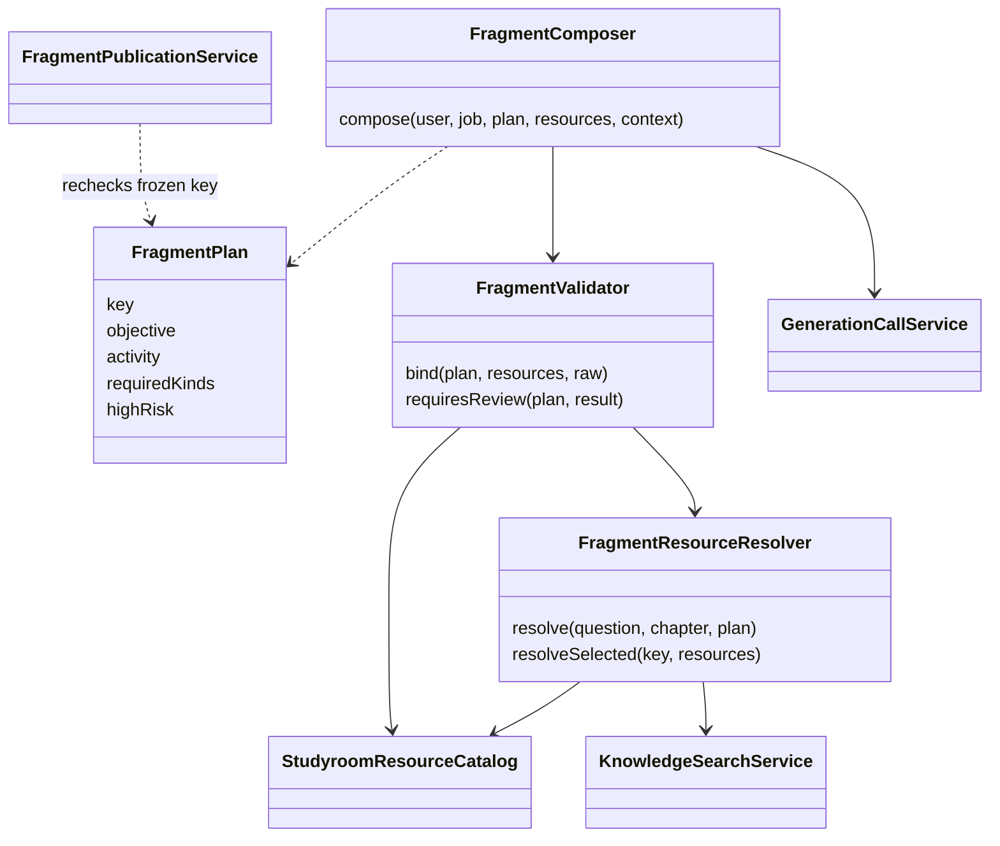
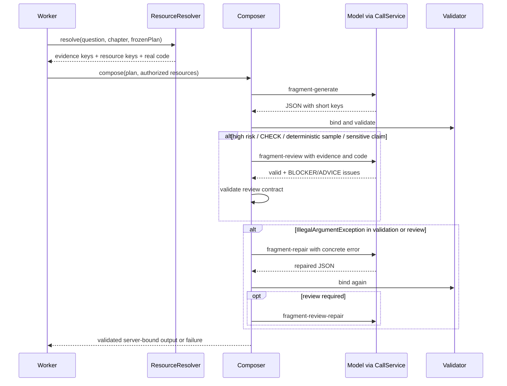

# A. 让模型提议内容，让服务端掌握计划与资源权限

- Status：Accepted（已提交且当前实现采用；原始批准记录待确认）
- Date：2026-10-24（追溯整理日期，不代表原始决策日期）
- Related commits / pull requests：898e3f6（审核大纲与资源编排的早期实现）；3ed94c1（片段计划基础）；79331bb（当前片段工作流相关实现）。这些提交是演进证据，不代表一次决策会或独立 PR 已获确认。
- Relation：原记录编号及路径保持不变，后续 Amends 关系见文末；无 Superseded 关系。

## Context（背景）

下述故障模型用于解释当前机制的必要条件，并非已确认发生的历史事故。代码能证明机制，不能证明原作者的动机；原方案不足与决策驱动的历史背景仍待确认。

教学 Agent 的危险不只是回答错一句话。它可能在生成时自行扩展学习范围、引用不存在的 PPT、解释没有展示的代码，甚至把预期输出描述成真实运行结果。若模型同时输出资源 ID、路径和参数，格式合法并不能证明该资源存在、属于当前章节或允许当前学生访问。提示词中的“不要幻觉”不能替代权限检查。

本项目把问题拆成两个层次：服务器先决定这次任务允许完成什么，以及有哪些可用材料；模型只在这一范围内写教学内容。最终发布前，服务器把模型使用的短键转换为可信资源引用。这是当前 Agent 的权限边界，体现了当前实现中模型与服务器的职责分工。

### 架构与依赖 UML

图中 Composer 负责内容生成，Resolver 负责构造可选资源集合，Validator 负责恢复可信引用。Publication 不调用模型。真实实现并非通用多 Agent 自由协作系统，而是有固定任务边界和有限修复次数的工作流。

## Decision（决策）

1. 审核后的计划冻结 `key/objective/activity/requiredKinds`。模型不能在这一调用里重新规划整门课。
2. Resolver 用用户问题与片段目标组成查询，在指定章节、学生可见范围内检索最多 6 条证据。没有证据直接失败，错误为 `FRAGMENT_EVIDENCE_UNAVAILABLE`。
3. 候选资源按教学活动过滤：代码只给 IMPLEMENTATION/EXPERIMENT，动画只给 PROCESS/EXPERIMENT。PPT 最多 4 个，其他类型分别最多 2 个。必要类型缺失则在调用前失败。
4. 证据映射成 `e1/e2`，资源映射成 `r1/r2`。动画参数由目录给出，模型只输出短键及讲解，不能提交资源 ID、类型、路径或任意参数。
5. Validator 解析严格结构，再查候选映射。未知证据键、未知资源键、重复资源、缺少必需类型都会阻断。代码结束行号不能超过真实源码行数；非代码场景不能带代码行号。需要执行的实验还须检查沙箱可用性。
6. 服务器构造 ResourceRef、场景和输出，再交给目录及场景适配器进行一致性校验。因此“JSON 能解析”只是入口，不是批准发布。

这里的短键类似一次调用内的能力引用：它限制模型能选的对象，但不是独立的安全令牌。真正授权仍依赖服务端候选集合及当前用户上下文。

### 生成、审查与有限修复时序

审查触发条件不是每次全量审查：`highRisk`、CHECK 活动、`floorMod(key.hashCode(),10)==0`，或正文涉及复杂度、运行输出、函数、边界等关键词时触发。哈希抽样约束的是稳定选择，并不意味着每批刚好 10%。最多一次修复，修复后失败继续向外传播；所有生成和审查共用预算。

## Considered Options（考虑过的方案）

以下为事后分析的可能替代方案。当前未确认原设计者当时曾评估、试验或正式排除这些方案，不将推演写成历史选型记录。

**让模型直接写最终资源引用。** 实现简单，但会把资源身份和参数控制交给不可信输出；服务器难以区分“格式正确”与“真正授权”。当前方案多了一次绑定，但可在确定性代码中拒绝错误引用。

**每次都调用第二模型审查。** 可增加审查覆盖，但成本与延迟随片段增长，且同类模型可能共享错误。当前实现结合确定性校验与风险触发审查；这减少调用，却不能保证所有普通正文的教学正确性。

**无限自我修复。** 容易形成昂贵循环，而且错误的审查也会推动内容反复变化。当前只修一次并消耗同一预算。本文这些替代方案是依据实现作出的分析，不声称存在历史横向实验。

## Consequences（影响与约束）

正面：把候选资源和参数的权威控制收回服务器，格式校验之后仍有确定性的绑定检查。

代价：候选构造、绑定及审查增加实现复杂度和延迟；限制候选数也可能漏掉更合适的材料。

新增约束：新资源类型必须同时扩展候选、输出协议及绑定校验；生成与修复不得绕过共享预算。

已知风险如下。

- 模型输出 `r999`：不在候选集，直接拒绝，不能靠模型声称“这个资源存在”通过。
- 模型给出第 150 行而源码只有 80 行：拒绝越界，不能把行号当作普通文本发布。
- 模型称“程序运行得到 42”但没有执行记录：提示词和教学审查要求阻断；这部分仍依赖语义审查，不能等同于形式化证明。
- 检索选错但仍合法的同章材料：短键绑定防不了语义错配。需检索质量评估；向量化也不能自动解决它。
- `resourceRevision` 当前由证据、候选、参数与代码表示计算哈希，是版本指纹；不能未经验证就宣称它是跨环境稳定的标准化内容地址。

## Implementation and Evidence（实现与证据）

- [FragmentResourceResolver](../../../backend/spring/src/main/java/com/feng/dsagent/studyroom/fragment/FragmentResourceResolver.java)：候选预算、活动过滤与短键映射。
- [FragmentValidator](../../../backend/spring/src/main/java/com/feng/dsagent/studyroom/fragment/FragmentValidator.java)：资源绑定、行号校验与审查触发。
- [FragmentComposer](../../../backend/spring/src/main/java/com/feng/dsagent/studyroom/fragment/FragmentComposer.java)：生成、审查、单次修复。
- 测试入口：`FragmentResourceResolverTest`、`FragmentValidatorTest`、`FragmentContractTest`。本次重写核对源码，未重新执行这些功能测试。

## Validation（验证）

静态源码可确认候选过滤、短键绑定、风险审查及一次修复；FragmentResourceResolverTest、FragmentValidatorTest、FragmentContractTest 是对应验证入口，本轮未运行。教学事实正确性、检索质量与审查召回率缺少已确认指标；Mermaid 保留源码，未做渲染验证。

## 待确认背景

哪些真实故障促成了该边界；候选数量和审查抽样的依据；审查成本与漏检目标；当时是否实际比较过其他方案。

## 后续补充决策 F

Amended by [F. 人工大纲编辑必须重新评估并写入独立修订](决策六-人工大纲编辑必须重新评估并写入独立修订.md)（Proposed）。此链接保留原决策；Proposed 不自动修改既有已生效规则。

## 后续补充决策 G

Amended by [G. 测验采用显式题库绑定并由模型补足至三题](决策七-测验采用显式题库绑定并由模型补足至三题.md)（Proposed）。此链接保留原决策；Proposed 不自动修改既有已生效规则。
