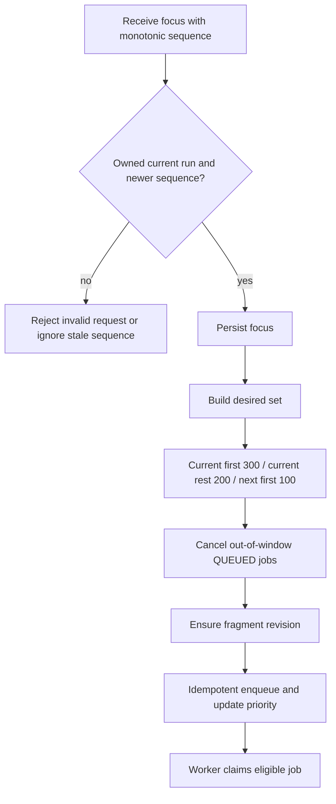
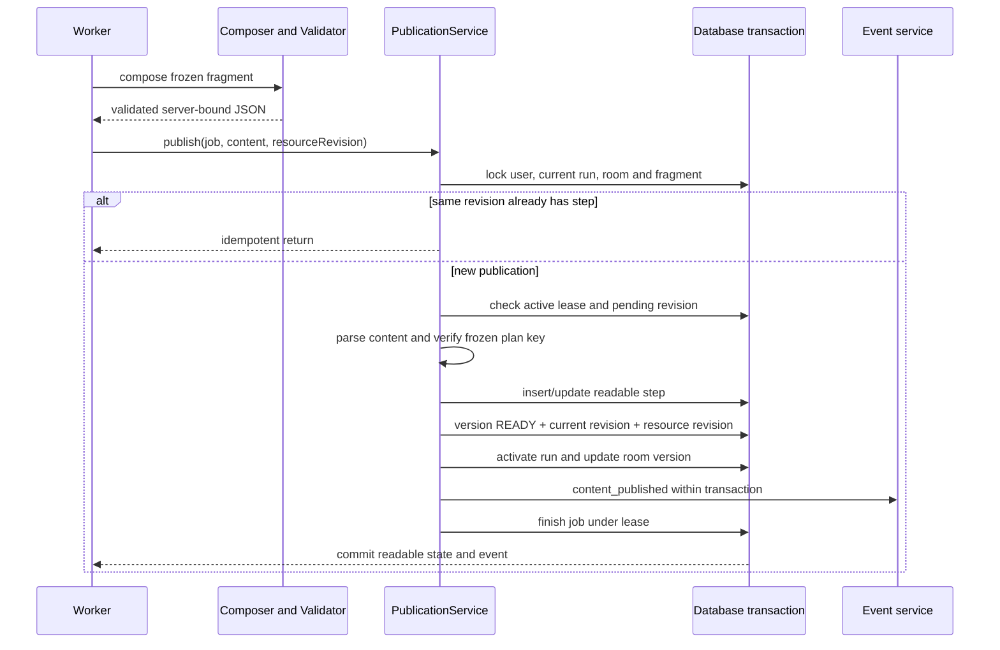
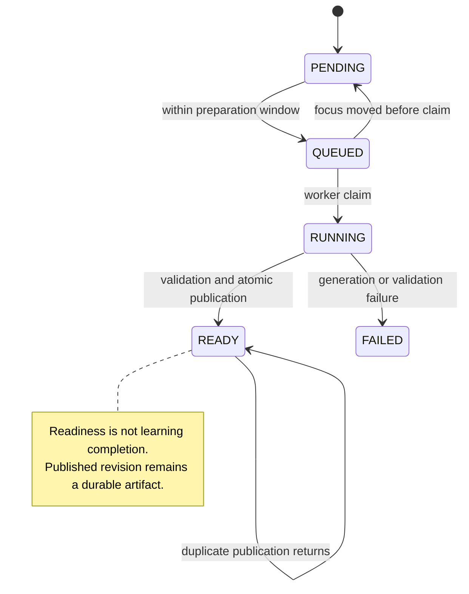

# C. 采用有界准备窗口并原子发布已验证片段

- Status：Accepted（已提交且当前实现采用；原始批准记录待确认）
- Date：2026-10-24（追溯整理日期，不代表原始决策日期）
- Related commits / pull requests：3ed94c1（片段存储与调度基础）；79331bb（渐进课堂和相关发布流程演进）。提交证明演进，不证明首次等待或成本已获得量化改善。
- Relation：原记录编号及路径保持不变，后续 Amends 关系见文末；无 Superseded 关系。

## Context（背景）

下述故障模型用于解释当前机制的必要条件，并非已确认发生的历史事故。代码能证明机制，不能证明原作者的动机；原方案不足与决策驱动的历史背景仍待确认。

整课一次生成会把首次等待、资源准备和模型费用集中到入口。学生尚未学习的章节也可能已经消耗预算；其中一个后续任务失败，若系统以“整课成功”为可读条件，就会丢失此前可用内容。另一端，完全按点击逐页生成虽然节省预取，却会令每次切换都等待模型。

当前设计选择有限预取：当前知识点的全部冻结片段，加下一个知识点的首片段。此设计没有测量数据证明全局最优；它明确控制准备范围，并让已完成的片段成为独立、可持续阅读的成果。

## Decision（决策）

`requestFocus` 先锁用户、确认 current run，检查知识点属于该 run，再比较 focus_sequence。旧序号或重复序号直接返回，避免迟到的导航请求把学习焦点倒退。

`reconcile` 按 unit_order 读取知识点，以持久进度选择 focus，无进度则用首点。它依序构造 desired：当前点首片段 priority=300，当前点其他片段=200，下一点首片段=100。注意优先级 300 的是冻结次序首片段，不是任意正在阅读的片段，不能把产品意图误写成代码已实现的细粒度优先调度。

对不在 desired 中、仍是 QUEUED 的 FRAGMENT job，标记 CANCELLED/FOCUS_CHANGED，并把仍为 QUEUED 的片段恢复 PENDING。不会在这里取消已经 RUNNING 的任务。对 desired 中 PENDING/QUEUED 的片段，确保版本记录存在，用 `fragment:<id>:<revision>` 入队并更新 priority。READY 或 RUNNING 等其他状态直接跳过。

代码按知识点与片段逐行查询，不应只写成抽象 O(n) 就忽略数据库往返。当前上界来自冻结计划和窗口范围；在课程规模或并发提高后，需要观测查询数、锁等待和排队时间，再决定批量查询或更复杂调度。用户级锁和同用户串行执行也会带来队头阻塞：较高优先级只能影响未领取任务，不能抢占已在执行的模型调用。

### 发布 UML：可读内容的线性化点

Publication 的事务包含可读 step、fragment version、当前 fragment、run/room 更新、可选测验发布、事件和 job 完成。服务端在这里重新核验当前 run、pending revision 和租约，防止“生成开始时合法，结束时已经过期”的结果覆盖当前课。

幂等分支在发现同 revision 已有 step 时提前返回，先于 active lease 检查。因此准确表述是：新发布必须具备活动租约；已完成的重复发布可无副作用返回，而不是所有调用都必须再次成功验证租约。

Publication 只做发布边界的结构与计划一致性检查，并不重新执行 Composer 的全部资源与教学审查。它依赖内部 worker 只传入已验证结果；不能把它描述成对任意外部 JSON 都独立完备的验证接口。架构测试因此有价值：应阻止绕过验证直接调用发布的未来改动。

### 状态分离：成功生成不等于学生学完

图是调度与生成的简化状态关系，不枚举所有重试/重生成接口。实际片段还有 content_revision、pending_revision 和历史版本，不能只靠一个 status 解释修订过程。学习进度独立记录；内容就绪、进入课程或发布新片段不应自动完成知识点。后续失败不应删除已发布正文；重生成失败后的具体读取行为应结合 ReadService 与测试判断，不能仅凭状态图推断。

### 与异步事件和追问的关系

事件流传递已提交状态，不拥有生成生命周期。浏览器重连只恢复游标，不应触发模型或取消任务。追问冻结 run、fragment、content revision 和已验证场景，形成独立 FOLLOWUP job，priority=400；比 FRAGMENT 排队优先，但仍不能抢占正在运行的任务。独立预算和关联上下文让追问失败不改写原片段。

这体现两个一致性域：数据库内课程发布可以事务化；数据库外模型调用只能通过账本与栅栏保守协调。SSE 是读取提交结果的通道，不是持久任务队列的替代品。

## Considered Options（考虑过的方案）

以下为事后分析的可能替代方案。当前未确认原设计者当时曾评估、试验或正式排除这些方案，不将推演写成历史选型记录。

- 整课全部预生成：后续切换快，但费用、入口延迟和过期结果更多。
- 纯点击生成：没有预取浪费，但每次首次阅读都可能等待模型。
- 发布时顺便调用模型：会把不可控网络延迟带入锁和事务，也模糊生成/发布职责。
- 用前端乐观状态当作发布成功：刷新后无法证明一致性，旧 run 也容易误覆盖。

当前选择增加版本、队列、幂等和事务实现成本，换来部分成果持续可读及明确发布点。它不是高并发调度的终局；缺少真实负载下的排队和成本曲线，仍应在扩展前测量。

## Consequences（影响与约束）

正面：有限窗口限制提前准备范围，片段有独立的发布事务与可读成果。

代价：窗口外首次阅读仍可能等待；窗口内生成也可能未被使用；版本、队列、幂等和事务增加维护成本。

新增约束：发布不得调用模型，生成结果必须先验证；新调度策略必须保持 focus_sequence 防倒退、旧 run 拒写和学习进度独立。

风险与后续：同用户串行执行会产生队头阻塞；当前窗口不保证全局最优。应测量排队、查询往返、锁等待和每个实际阅读片段的成本，再讨论扩大预取。

## Implementation and Evidence（实现与证据）

- [PreparationScheduler](../../../backend/spring/src/main/java/com/feng/dsagent/studyroom/fragment/PreparationScheduler.java)：序号防倒退、窗口和优先级算法。
- [FragmentPublicationService](../../../backend/spring/src/main/java/com/feng/dsagent/studyroom/fragment/FragmentPublicationService.java)：事务与重复发布分支。
- [FragmentReadService](../../../backend/spring/src/main/java/com/feng/dsagent/studyroom/fragment/FragmentReadService.java)：可读投影。
- 测试入口：`PreparationSchedulerTest`、`FragmentPublicationServiceTest`、`FragmentReadServiceTest`、`ProgressiveOutlineConfirmationTest`、`StudyroomArchitectureTest`。本次核对源码，未重新执行功能测试。

## Validation（验证）

源码可确认当前点全部片段加下一点首片段的窗口、优先级和事务发布检查。PreparationSchedulerTest、FragmentPublicationServiceTest、FragmentReadServiceTest、ProgressiveOutlineConfirmationTest、StudyroomArchitectureTest 是验证入口，本轮未运行。真实负载性能、失败后阅读体验及 Mermaid 渲染仍待验证，旧验收记录不等于本次工作区验证。

## 待确认背景

窗口大小与优先级的业务依据；首次可读延迟和无效生成成本目标；历史旧方案的实际测量；发布与学习进度分离是否已有正式产品批准。

## 后续补充决策 D

Amended by [D. 限制课堂事件订阅并隔离连接与生成生命周期](决策四-限制课堂事件订阅并隔离连接与生成生命周期.md)（Accepted）。此链接保留原决策；Proposed 不自动修改既有已生效规则。
