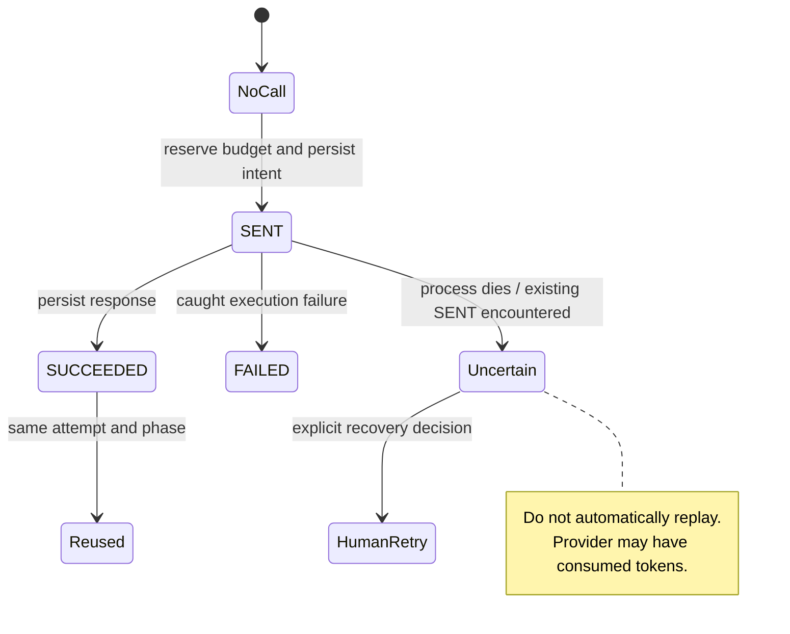
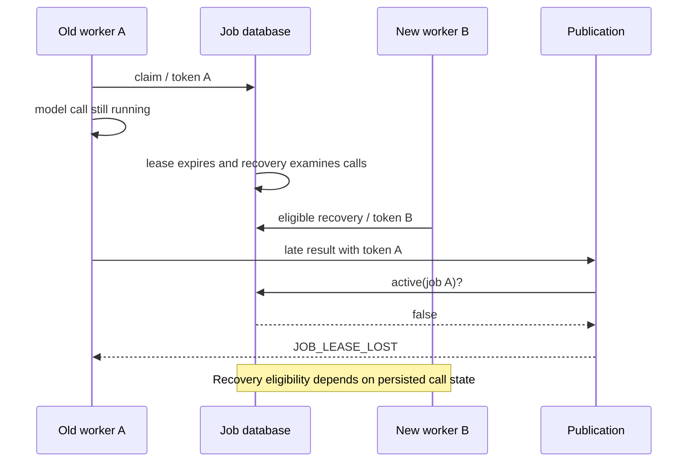

# B. 用调用账本、租约和修订预算约束智能体执行

- Status：Accepted（已提交且当前实现采用；原始批准记录待确认）
- Date：2026-10-24（追溯整理日期，不代表原始决策日期）
- Related commits / pull requests：898e3f6（调用账本、任务及租约基础）；3ed94c1（片段预算结构）；79331bb（片段用量和课堂任务预算演进）。PR 归属与原始批准日期待确认。
- Relation：原记录编号及路径保持不变，后续 Amends 关系见文末；无 Superseded 关系。

## Context（背景）

下述故障模型用于解释当前机制的必要条件，并非已确认发生的历史事故。代码能证明机制，不能证明原作者的动机；原方案不足与决策驱动的历史背景仍待确认。

假设服务已把请求发给模型，模型已计费，进程却在保存响应前退出。数据库只知道“发过”，不知道供应商是否执行成功。自动重发可能重复收费并产生两个不同结果。数据库事务无法回滚外部模型调用，因此不能用一个大事务宣称端到端 exactly-once。

另一类故障来自过期 worker：任务租约过期后，新 worker 接管，旧 worker 仍可能收到响应。仅检查 job ID 不够；旧 worker 必须失去后续调用和发布资格。同时，生成、审查和修复必须共享总预算，否则“每步限制一次”仍可能在恢复后无限消费。

## Decision（决策）

CallService 在短事务内锁定用户与任务，检查 RUNNING、当前 run 和租约身份。以 `job_id + attempt + phase` 查已有调用；已有 SUCCEEDED 直接返回持久响应。新调用先插入 SENT 并分配 `quota_request_id`，事务结束后才访问模型。模型响应写入 SUCCEEDED，再记录 usage。调用请求 ID 与额度请求 ID 相同，用于关联执行和记账。

如果查到旧 SENT，当前调用者不是原插入者，则返回 `MODEL_CALL_UNCERTAIN`，要求主动重试；不会自动再打一遍模型。这牺牲无人值守恢复速度，换取避免不确定外部副作用的保守行为。即使这样，也不能宣称供应商计费恰好一次。

### 调用状态 UML

`Uncertain/Reused/HumanRetry` 是解释用的逻辑状态，不是数据库中新增的 status 值。FAILED 也不代表供应商没有计费；失败时同样记录真实或估算用量。

### 租约栅栏

Repository claim 按 priority 降序领取到期的 QUEUED 任务，并在用户锁内限制同一用户只有一个 RUNNING。领取产生 lease token，期限为 120 秒；heartbeat 续到当前时刻后 120 秒。`active` 同时检查任务 RUNNING、token 相等和期限未到。Worker 本地通过 ThreadLocal 保存本次 lease 身份，后续调用据此校验。

此图强调“身份变化使旧结果失效”，不表示所有过期任务都会自动交给 B。Repository recovery 需要查看已发调用，不能把有不确定副作用的任务一律回队。

### 预算算法与边界

普通 fragment 默认共享上限为 4 次调用、20000 tokens、8 分钟累计活动时间，配置可覆盖。预算属于 `fragment_id + revision`，不是单次 HTTP 请求；重试不能通过新建请求清零同一修订账本。

调用前估算预留量：`ceil((system.length + prompt.length) / 4) + maxOutputTokens`。事务锁定 fragment version，检查剩余调用数、已消耗时间和 tokens，再增加 consumed_calls 和预留 tokens。完成后以供应商 totalTokens 为优先，否则估算，按 `actual - reserved` 调整总账，累计 elapsed_ms。

该估算法按 Java 字符串长度近似，不是真 tokenizer，尤其不能把中文 4 字符视作准确 1 token。预算检查在调用开始前进行，供应商实际用量仍可能超估；累计时间也不能被表述成每次同步调用都受到精确的 8 分钟强制截止。流式回调另外检查单次 120 秒、输出 64000 字符、租约及任务状态。

FOLLOWUP 的预算为最多 2 次、20000 tokens、120 秒累计活动时间；CHECK 为最多 1 次、10000 tokens，使用独立 job 的调用记录汇总，不借用源片段预算。一次回答完成后，可选附件失败不能抹掉已有正文。

## Considered Options（考虑过的方案）

以下为事后分析的可能替代方案。当前未确认原设计者当时曾评估、试验或正式排除这些方案，不将推演写成历史选型记录。

无限重试会放大费用和副作用。仅有锁能约束同一时刻的执行，却不能证明旧进程永久停止，也不能解决模型已执行但响应丢失。租约 token 负责拒绝过期身份，调用账本负责保留不确定性，修订预算负责限制持续消耗，三者处理不同问题，缺一不能由另一个替代。

## Consequences（影响与约束）

正面：账本保留外部调用的不确定性，租约阻止过期身份继续写入，修订预算约束跨步骤消费。

代价：不确定调用需要主动恢复，自动化可用性降低；数据库锁、心跳与账目维护增加复杂度，用户串行执行可能产生等待。

新增约束：新调用 phase 必须经过统一调用服务，失败仍需核算用量，任务恢复不能清零既有修订预算。

已知风险与观测边界如下。

CallService 记录 phase、job、call、elapsedMs、tokens 和 usageSource，并通过 Observation 标记 outcome。这可以定位耗时与成本，却不能直接证明生成质量。响应持久化与 usage 更新并非跨供应商原子事务，崩溃窗口仍应作为核账风险保留。独立测试账号“无限额度”也不应混同于 fragment 工作流的有限预算。

## Implementation and Evidence（实现与证据）

- [GenerationCallService](../../../backend/spring/src/main/java/com/feng/dsagent/studyroom/generation/GenerationCallService.java)：SENT 语义、复用、预算预留和用量归账。
- [JdbcGenerationRepository](../../../backend/spring/src/main/java/com/feng/dsagent/studyroom/generation/JdbcGenerationRepository.java)：claim、active、heartbeat、recover。
- [GenerationLease](../../../backend/spring/src/main/java/com/feng/dsagent/studyroom/generation/GenerationLease.java)：worker 级身份。
- 测试入口：`FragmentExecutionBudgetIntegrationTest`、`FragmentReplayTest`、`GenerationCallStreamingTest`、`FragmentBudgetTest`。本次未重新运行。

## Validation（验证）

源码可确认 SENT 先行、SUCCEEDED 复用、租约身份判断和预算预留/归账。FragmentExecutionBudgetIntegrationTest、FragmentReplayTest、GenerationCallStreamingTest、FragmentBudgetTest 是验证入口，本轮未运行。供应商计费一致性、进程崩溃窗口核账与真实 tokenizer 误差待验证；不宣称端到端 exactly-once。

## 待确认背景

不确定调用恢复是否有正式运维流程；预算与租约数值来源；历史上是否发生重复收费或旧 worker 回写；当时评估过的方案和接受的人工恢复成本。

## 后续补充决策 E

Amended by [E. 将模型输出截断判为失败并保留调用用量](决策五-将模型输出截断判为失败并保留调用用量.md)（Accepted）。此链接保留原决策；Proposed 不自动修改既有已生效规则。

## 后续补充决策 H

Amended by [H. 仅为开发账号豁免每日额度而保留工作流约束](决策八-仅为开发账号豁免每日额度而保留工作流约束.md)（Proposed）。此链接保留原决策；Proposed 不自动修改既有已生效规则。
