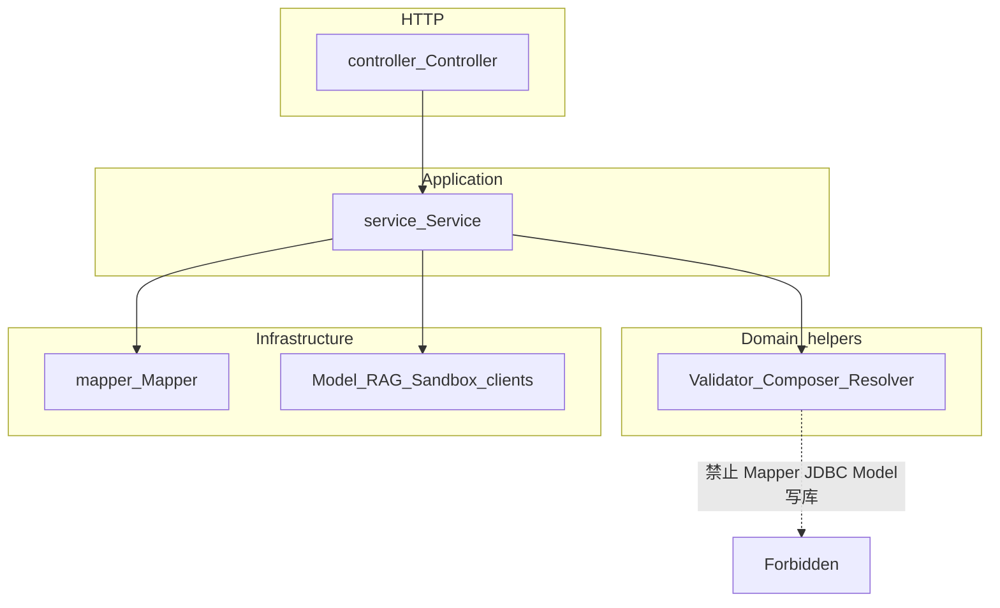
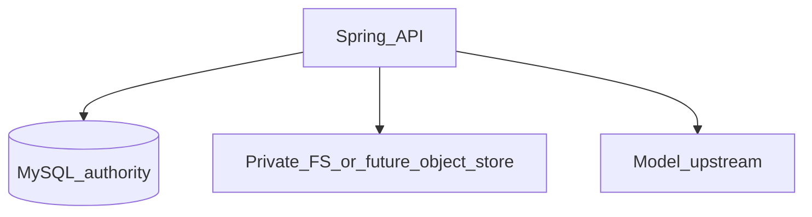

# Spring 后端工程规范

适用范围：[`backend/spring`](../../backend/spring)。Node 兼容服务（`backend/node`，`/api/*`）不是本规范对象；禁止向 Node 写入新的产品工作流。

Agent 业务决策（计划冻结、租约、预算、原子发布等）以 [后端 ADR](../adr/backend/阅读指南.md) 与 [学习室架构状态](studyroom.md) 为准。本文件约束工程形态、分层、数据访问与可强制规则。

HTTP 契约 SSOT：[`contracts/openapi-v1.yaml`](../../contracts/openapi-v1.yaml)。Schema SSOT：Flyway migrations。

---

## 1. 架构形态

Spring 后端是**按业务能力分包**的模块化单体（如 `studyroom`、`compiler`、`knowledge`、`auth`）。**禁止**仓库根下的全局 `controller/` / `service/` 技术分层；**每个能力模块（及 studyroom 等子域）内部**使用固定子包：

| 子包 | 内容 |
|------|------|
| `...controller` | `*Controller` |
| `...service` | `*Service`（应用编排） |
| `...mapper` | MyBatis `*Mapper` 接口 |
| （同模块其它包） | Worker、Validator、DTO、领域辅助等 |

示例：`com.feng.dsagent.auth.controller.AuthController`、`com.feng.dsagent.auth.service.AuthService`、`com.feng.dsagent.studyroom.draft.controller.OutlineController`、`com.feng.dsagent.studyroom.draft.service.OutlineService`。



包内角色：

| 角色 | 职责 |
|------|------|
| `*.controller.*Controller` | 认证主体、请求校验、调用 Service、HTTP 映射 |
| `*.service.*Service` / Worker / Scheduler | 编排、事务、权限与配额、调用 Mapper 与受控客户端 |
| `*.mapper.*Mapper` + XML | SQL 与结果映射 |
| Validator / Composer / Resolver / PlanCompiler | 无状态变换与校验 |

跨包只允许应用服务调用另一能力的公开 API。Controller 不互相调用，也不直接依赖其他包的 Mapper。

---

## 2. 分层硬规则

| 角色 | 允许 | 禁止 |
|------|------|------|
| Controller | `@AuthenticationPrincipal`、DTO/`@Valid`、调 Service、状态码与信封 | `JdbcTemplate`、Mapper、手写 SQL、`com.feng.dsagent.model` 客户端、发布/账本副作用 |
| Service / Worker | `@Transactional`、权限/配额、调 Mapper、受控外部客户端 | **新代码**直接 `JdbcTemplate`；在 Java 中拼接长期 WHERE；把 SQL 藏在业务方法里而不进 XML |
| Mapper + XML | 语句、`resultMap`、参数绑定 | 业务策略、HTTP、调模型 |
| Composer / Validator / PlanCompiler | 纯变换与校验 | Mapper、JDBC、发布服务、模型写调用（与 studyroom fragment ArchUnit 一致） |

强制测试：[`BackendArchitectureTest`](../../backend/spring/src/test/java/com/feng/dsagent/architecture/BackendArchitectureTest.java)。Service 不得依赖 `JdbcTemplate`；Controller 不得依赖 JDBC / Mapper / `model` 客户端。

---

## 3. MyBatis 约定

持久化**访问层**统一为 MyBatis Mapper 接口 + XML。Flyway 只管 schema；MyBatis 只管语句与映射。数据源仍由 `spring-boot-starter-jdbc` 提供。禁止引入 JPA / Spring Data JPA / `@Entity`。

### 3.1 目录与命名

| 项 | 约定 |
|----|------|
| 接口包 | `com.feng.dsagent.<capability>.mapper` |
| 接口名 | `FooMapper`，标注 `@Mapper` |
| XML | `src/main/resources/mapper/<capability>/FooMapper.xml` |
| `namespace` | 接口全限定名 |
| 语句 `id` | 与接口方法名一致 |

示例（文档示意，非要求本轮已落地的生产 Mapper）：

```java
package com.feng.dsagent.auth.mapper;

import org.apache.ibatis.annotations.Mapper;
import org.apache.ibatis.annotations.Param;

@Mapper
public interface UserAccountMapper {
    String findEmailById(@Param("id") long id);
}
```

```xml
<?xml version="1.0" encoding="UTF-8" ?>
<!DOCTYPE mapper PUBLIC "-//mybatis.org//DTD Mapper 3.0//EN"
  "https://mybatis.org/dtd/mybatis-3-mapper.dtd">
<mapper namespace="com.feng.dsagent.auth.mapper.UserAccountMapper">
  <select id="findEmailById" resultType="string">
    SELECT email FROM users WHERE id = #{id}
  </select>
</mapper>
```

### 3.2 编写规则

- 复杂查询与动态 SQL 默认写在 XML；简单单字段可用注解，但表级 CRUD 默认 XML。
- 多参数必须 `@Param`；禁止无名字的 `Map` 作为长期 Mapper API。
- 动态条件用 `<if>` / `<where>` / `<foreach>`；禁止在 Java 中拼接 WHERE 子句。
- 分页与批量：优先显式 `LIMIT`/`OFFSET` 参数；引入 PageHelper 等插件须单独评审。本规范不强制 PageHelper。
- 列变更：先 Flyway migration，再改 XML。Mapper 不得假设未迁移列存在。
- **新功能 / 新表访问必须走 Mapper。** 改动触及旧 `Jdbc*` / Service 内 SQL 时优先迁 Mapper；不要求一次清零。
- 不再鼓励新建 `Jdbc*Repository`。既有 `Jdbc*` 实现为遗留，改到时再替换。

### 3.3 配置入口

- 依赖：`org.mybatis.spring.boot:mybatis-spring-boot-starter`（与当前 Spring Boot 主版本对齐，见 `pom.xml`）。
- `@MapperScan`：[`MyBatisConfig`](../../backend/spring/src/main/java/com/feng/dsagent/config/MyBatisConfig.java)。
- `application.yml`：`mybatis.mapper-locations=classpath:mapper/**/*.xml`，`map-underscore-to-camel-case=false`。
- **Map 结果键名：** typed `resultType` / `resultMap` 仍可按 Java bean 属性映射；但 studyroom 等以 `Map`/`Map<String,Object>` 承接列的 SQL **保留 snake_case 列标签**（与迁 Mapper 前的 JdbcTemplate `queryForMap` 行为一致）。服务层读取 `draft.get("confirmed_run_id")`、`row.get("last_sequence")` 等，故全局关闭 `mapUnderscoreToCamelCase`，避免 MyBatis 把 Map 键改成 camelCase。新代码若用强类型 DTO，再在该映射路径上显式约定。

---

## 4. API 与契约

- 新接口：先改 OpenAPI，再实现；路径仅 `/api/v1/*`。
- 成功体：裸资源 DTO（无全局 `{ ok: true }` 包装）；若个别响应含 `ok` 等字段，必须写进 OpenAPI。
- 错误体：唯一信封 `{ code, message, requestId, details }`（[`ApiError`](../../backend/spring/src/main/java/com/feng/dsagent/common/ApiError.java)）。受控失败抛 [`ApiException`](../../backend/spring/src/main/java/com/feng/dsagent/common/ApiException.java)（或已映射子类）。
- SSE / 非 JSON：经 [`ApiErrors`](../../backend/spring/src/main/java/com/feng/dsagent/common/ApiErrors.java) 旁路写出，不依赖内容协商。
- 常用状态码：200 / 201 / 202 / 204；400 校验；401 未认证；403 已认证无权限；404 不存在或不可见（不泄露存在性）；409 状态/幂等冲突；429 限流或配额；5xx 未预期或上游。
- `X-Request-Id`：请求追踪。`Idempotency-Key`：写去重（studyroom 状态变更类必须）。浏览器 CORS 须放行 `Idempotency-Key`（见 `SecurityConfig`）。

---

## 5. 持久化与迁移

- **业务权威库：MySQL**（本地开发可用 H2 `MODE=MySQL`）。不以「上 pgvector」为由整库迁 PostgreSQL；向量索引与事务库分离。
- 访问层：MyBatis；Schema：Flyway（`classpath:db/migration`）。
- 仅正向、版本唯一的 migration；禁止启动时 reset 数据库；开发勿双开同一 H2 文件（见 [`AGENTS.md`](../../AGENTS.md)）。
- 文档不复制整套 DDL；以 migration 与 OpenAPI 为准。

---

## 6. 数据面与外部依赖（选型）

本节省略「一次上齐全家桶」；组件按职责引入，避免把运维复杂度当成完整性。

| 职责 | 当前选型 | 说明 |
|------|----------|------|
| 权威状态与事务 | **MySQL**（开发 H2） | 用户、大纲、run/fragment、job、配额、课件**元数据** |
| 知识检索 | **词法快照**（`KnowledgeSearchService`） | 库内已发布 chunk + eligibility；外部向量 RAG 未纳入本重构基线 |
| 课件 / PPT 二进制 | **私有文件系统目录**（`RESOURCE_DIR` / `PRESENTATION_*`） | 下一步演进方向：对象存储（S3/MinIO 兼容），元数据仍在 MySQL；签名 URL 与「不可见=404」语义保持 |
| 缓存 | **未作为产品核心依赖** | 需要时仅缓存热点只读；不缓存权威生成状态或配额真相 |
| 消息队列 | **未引入** | 异步继续用 DB job + worker + 租约/fencing；水平扩展多 worker 之前不上 MQ |



约束：

- 模型调用与数据库不在同一原子事务。
- 检索须先过 audience / eligibility / 章节约束，再使用词法命中；不得把未落地的向量增强写成已交付。
- 禁止把 Node SQLite 或对象存储当作第二套权威业务库。

---

## 7. 安全与权限

- 主体：`AuthenticatedUser` + `@AuthenticationPrincipal`；角色：`@PreAuthorize`。
- 私有资源不可见时返回 **404**，不用 403 泄露存在性。
- 密钥、JWT、`.env`、数据库文件不入库。模型与沙箱为受控依赖；缺配置 fail-closed（如 `MODEL_NOT_CONFIGURED`）。

---

## 8. 异步、幂等与权威状态

- 长任务：数据库 job + worker（当前未引入消息中间件作为产品依赖）。
- 模型调用与数据库不在同一原子事务；发布事务只保证库侧一致。细节见 ADR-B / ADR-C。
- 服务端控制资源绑定、预算、权限与发布；模型只提议教学内容。

---

## 9. 测试与验证

| 层级 | 约定 |
|------|------|
| 单测 | `*Test.java`，无 Spring 或轻量上下文 |
| API / 集成 | `*ApiIntegrationTest` / `*IntegrationTest`，profile `test` |
| 架构 | `BackendArchitectureTest`、`StudyroomArchitectureTest` |
| 契约 | OpenAPI + `fixtures/http` + `scripts/verify-api-contract-fixtures.js` |

命令：

```text
node scripts/verify-studyroom.mjs --scope backend
node scripts/verify-studyroom.mjs --scope architecture
```

`architecture` scope 须包含 `BackendArchitectureTest`。

---

## 10. 分层强制（当前无例外）

[`BackendArchitectureTest`](../../backend/spring/src/test/java/com/feng/dsagent/architecture/BackendArchitectureTest.java) **不再维护白名单**。下列规则无赦免条目：

- `@RestController` 不得依赖 `JdbcTemplate` / Mapper / `com.feng.dsagent.model`
- `*Service` 不得依赖 `JdbcTemplate` / `NamedParameterJdbcTemplate`（须走 MyBatis Mapper）
- 禁止 JPA

遗留 `Jdbc*Repository` 可仍被 Worker 等非 `*Service` 类型使用；触改时再迁 Mapper，**禁止**再把 JDBC 写回 Service。

---

## 11. PR 自检清单

- [ ] 若改 HTTP：已更新 `contracts/openapi-v1.yaml`（及必要 fixtures）
- [ ] 错误使用稳定 `code`（`SCREAMING_SNAKE`）与 `ApiError` 信封
- [ ] Controller 未新增 JDBC / Mapper / model 客户端依赖
- [ ] 新 SQL 位于 `mapper/**/*.xml`（或经评审的注解 Mapper），未在 Service 内新增长期拼接 SQL
- [ ] 新 Service 未使用 `JdbcTemplate`；持久化经 Mapper + XML
- [ ] Schema 变更有唯一正向 Flyway 版本；未擅自把权威库换成 Postgres「顺便上 pgvector」
- [ ] 涉及检索/RAG：未把未激活 release 写成已上线能力；向量路径仍受权限过滤
- [ ] 已跑 `verify-studyroom --scope architecture`（及触及行为时的 `backend`）
- [ ] 未提交密钥、`.env`、数据库文件或本地课件导出

---

## 相关入口

- [系统架构](../系统架构.md)
- [学习室架构状态](studyroom.md)
- [后端 ADR 阅读指南](../adr/backend/阅读指南.md)
- [Node/Spring 兼容差异](node-spring-compat.md)
- [backend/spring README](../../backend/spring/README.md)
