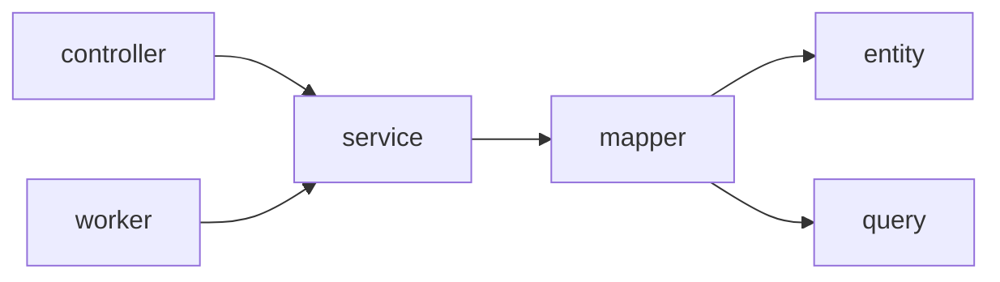

# Spring 后端工程规范

适用范围：[`backend/spring`](../../backend/spring)。Node 兼容服务（`backend/node`，`/api/*`）不是本规范对象；禁止向 Node 写入新的产品工作流。

Agent 业务决策（计划冻结、租约、预算、原子发布等）以 [后端 ADR](../adr/backend/阅读指南.md) 与 [学习室架构状态](studyroom.md) 为准。本文件约束工程形态、分层、数据访问与可强制规则。

HTTP 契约 SSOT：[`contracts/openapi-v1.yaml`](../../contracts/openapi-v1.yaml)。Schema SSOT：Flyway migrations。

**与实现关系：** 条文写终态；存量按模块清零。新增代码必须合规。ArchUnit / 布局校验强制执行。

---

## 1. 架构形态

Spring 后端是**按业务能力分包**的模块化单体（如 `studyroom`、`compiler`、`knowledge`、`auth`）。**禁止**仓库根下的全局 `controller/` / `service/` / `dto/` / `vo/` / `entity/` 技术分层；**禁止**再按「管理端 / 学生端」做顶层二分（现有业务包名 `admin` 保留；受众用 `@PreAuthorize` / URL 前缀区分）。

### 1.0 根包禁令

`com.feng.dsagent.<capability>` 与 `com.feng.dsagent.studyroom.<subdomain>` 的**直接包**下不得有生产类型（仅允许空目录或 `package-info`）。所有类型必须进入下列固定叶子包。

平台例外：应用入口、`common.*`、根 `config.*`、`model.*`（LLM 客户端）。

### 1.1 强制叶子包

| 叶子包 | 允许类型 | 规则 |
|--------|----------|------|
| `controller` | 仅 `*Controller` | `@Valid` 在**方法参数**上触发；字段约束在 DTO 上 |
| `service` | 仅 `*Service` | 应用编排；**禁止** `JdbcTemplate`、`Connection`、拼接 SQL |
| `mapper` | 仅 MyBatis `*Mapper` **接口** | **唯一**持久化访问面；SQL 见 §3（XML 不在 Java 树） |
| `converter` | 仅 MapStruct `*Converter` | Entity/领域 ↔ VO/DTO；**禁止**命名为 `*Mapper`；禁止 BeanUtils |
| `dto` | HTTP/应用入参 | 简单名必须以 **`DTO` 结尾**；**禁止 `*Write`** |
| `vo` | 出参 | 简单名必须以 **`VO` 结尾**；分页统一 `common.vo.PageVO`（JSON 仍 `items/page/size/total`）；**禁止**含 `passwordHash` |
| `entity` | 行对象 | 简单名必须以 **`Entity` 结尾** |
| `query` | 筛选条件 | 仅 `*Query`（按 ID 查可不建） |
| `domain` | 枚举、纯领域对象、值对象 | **不得**依赖 Spring Web、MyBatis、DTO、VO、PO；**不**承担应用编排 |
| `config` | `*Configuration` / `*Properties` | Spring 装配 |
| `error` | `*ErrorCode` 枚举 | 实现公共 `ErrorCode`；禁止 `*ErrorCodes` 双风格 |
| `exception` | 少数需差异处理的异常 | 业务码主路径用 `BizException(ErrorCode)` |
| `prompt` | `*Prompts` | 固定提示词常量 |
| `support` | Validator / Parser / Composer / Crypto / Limiter / 私有工具 | 仅本 capability 辅助；多 capability 复用再下沉 `common` |
| `worker` | Worker / Scheduler / `*Runner` | **只**调度 / 异步 / 启动装载；业务调 **Service**；**不得**直调 Controller |

**不设 `repository` 叶。** 存量 JDBC `*Repository` 必须迁为 `mapper` + XML + `entity` 后删除；禁止新增 JDBC 持久化类。

示例：`com.feng.dsagent.auth.controller.AuthController`、`com.feng.dsagent.review.vo.ReviewItemView`、`com.feng.dsagent.admin.entity.AdminUserEntity`、`com.feng.dsagent.studyroom.draft.controller.OutlineController`。

跨能力平台装配继续放在根包 [`com.feng.dsagent.config`](../../backend/spring/src/main/java/com/feng/dsagent/config/)。产品「配置」能力（`mail` / `modelconfig` / compiler sandbox）仍是独立能力包，**不**迁入某模块的 `.config`。

### 1.2 跨包依赖（写死）

```text
Controller → Service → Mapper
Worker     → Service
```



- Controller **不得**直接访问 Mapper、Entity、Query。
- Service **不得**依赖 Controller 或 Spring Web 请求对象；不得 `JdbcTemplate` / `Connection` / 拼 SQL。
- Mapper **只**使用 Entity、Query 及简单参数；**不**处理 HTTP DTO、VO。
- **capability 之间**不得互相访问对方的 Mapper、Entity、Query 等内部实现；跨能力只经对方公开 Service。

### 1.3 命名与新建纪律

**总则：所有类名必须一眼看出作用**——简单名即可判断叶子角色与业务职责；看不出作用的名字不合格。

1. **禁止随意起名**：`dto`/`vo`/`entity` 必须分别以 `DTO`/`VO`/`Entity` 结尾；不得发明平行后缀（`*Write`、`*Helper2` 等）。
2. **禁止语义不清**：禁止含糊主名；搬家时若旧名空洞须同批改名。
3. **禁止未读既有类就新建**：先搜索同职责类型；优先迁入 / 改名 / 合并。

### 1.3.1 对象映射

- **禁止** `BeanUtils` / 反射批量拷贝。
- **优先 MapStruct** `*Converter`（`converter` 包）；多字段或复用必须 Converter；≤3 字段可 Service 内手工 `new`。
- 生成类仅构建产物，禁止手改。

### 1.3.2 日志体系

- 仅 SLF4J；参数化 `log.info("userId={}", id)`；禁 `System.out` / `printStackTrace`。
- `error` 未预期（带异常）；`warn` 可降级；`info` 关键业务节点；`debug` 细节。
- HTTP `requestId` 写入 **MDC**（`RequestIdFilter`）；log pattern 含 `%X{requestId}`。
- 禁止记录密码、token、完整密钥、验证码明文。Worker 须传递/恢复 MDC。

### 1.3.3 注释体系

- 公开边界类型（controller/service/mapper/converter/error 及非显然 dto/vo/entity）须有**短 JavaDoc：职责**。
- 非显然不变量、安全/租约/fencing/预算写「为什么」。
- 禁止复述代码的废话、大段注释掉的死代码、过时谎言注释；禁止用注释代替清晰命名。

### 1.4 错误码与成功体

- **成功体：裸资源 VO**，不引入 API 层 `Result<T>` / `R<T>`（与 OpenAPI / 前端契约一致）。
- **失败：** 抛 `BizException(ErrorCode)`（或已映射的少数特殊异常）→ 统一 [`ApiError`](../../backend/spring/src/main/java/com/feng/dsagent/common/exception/ApiError.java) 信封。遗留 `ApiException` 按模块迁到 `BizException`。
- **错误码**在 `<capability>.error.*ErrorCode`，实现公共 `ErrorCode`；禁止业务字面量 `code`；OpenAPI 已依赖的字符串**不改语义**。

### 1.5 提示词

系统提示 / 可复用指令进 `<capability>.prompt.*Prompts`；Service 只引用。禁止塞进 `dto`/`vo`/`entity`，也不建根全局 `Prompts.java`。本期仍是 Java 常量。

### 1.6 Exception 分包

| 类型 | 包 |
|------|----|
| `BizException`、`ApiException`（遗留）、`ApiError`、`ApiExceptionHandler` 等 | `common.exception` |
| 能力特有、确需差异处理的异常 | `<capability>.exception.*Exception` |
| 仅模型客户端用的异常 | 可留 `model` / `model.exception` |

---

## 2. 分层硬规则

| 角色 | 允许 | 禁止 |
|------|------|------|
| Controller | `@AuthenticationPrincipal`、DTO/`@Valid`、调 Service、状态码与信封 | `JdbcTemplate`、Mapper、手写 SQL、`model` 客户端、发布/账本副作用 |
| Service | `@Transactional`、权限/配额、调 Mapper、受控外部客户端 | `JdbcTemplate`、`Connection`、拼 SQL、依赖 Controller / servlet 请求 |
| Worker | 调度后调 Service | 直调 Controller；复制一套业务链路 |
| Mapper + XML | 语句、`resultMap`、参数绑定 | 业务策略、HTTP、DTO/VO、调模型 |
| support（Validator/Composer/Converter…） | 纯变换与校验 | 业务流程、Mapper、长期 SQL |

强制测试：[`BackendArchitectureTest`](../../backend/spring/src/test/java/com/feng/dsagent/architecture/BackendArchitectureTest.java)。

---

## 3. MyBatis 约定

持久化**唯一**访问层为 MyBatis Mapper 接口 + XML。禁止 JPA / Spring Data JPA / `@Entity`。禁止能力内 `*Repository` / `..repository..`。

### 3.1 目录与命名

| 项 | 约定 |
|----|------|
| 接口包 | `com.feng.dsagent.<capability>.mapper`（Java 仅接口） |
| 接口名 | `FooMapper`，标注 `@Mapper` |
| XML | **仅** `src/main/resources/mapper/<capability>/FooMapper.xml` |
| `namespace` | 接口全限定名 |
| 语句 `id` | 与接口方法名一致 |

**禁止**把 Mapper XML 放在 `src/main/java` 旁或与接口同包目录。studyroom 子域：`resources/mapper/studyroom/<subdomain>/`。

### 3.2 编写规则

- 复杂查询与动态 SQL 默认写在 XML；表级 CRUD 默认 XML。
- 多参数必须 `@Param`；禁止无名字的 `Map` 作为长期 Mapper API。
- 动态条件用 `<if>` / `<where>` / `<foreach>`；禁止在 Java / Service 中拼接 WHERE。
- 列变更：先 Flyway，再改 XML。
- **新功能 / 新表必须走 Mapper。** 存量 JDBC Repository 本轮按模块迁完并删除。

### 3.3 配置入口

- `@MapperScan`：[`MyBatisConfig`](../../backend/spring/src/main/java/com/feng/dsagent/config/MyBatisConfig.java)。
- `application.yml`：`mybatis.mapper-locations=classpath:mapper/**/*.xml`，`map-underscore-to-camel-case=false`（Map 结果键保留 snake_case，与历史 JdbcTemplate 行为一致）。

---

## 4. API 与契约

- 新接口：先改 OpenAPI，再实现；路径仅 `/api/v1/*`。
- 成功体：裸资源 VO；分页字段名保持 `items` / `page` / `size` / `total`（Java 类型 `PageVO`）。
- 错误体：`{ code, message, requestId, details }`。
- SSE / 非 JSON：经 [`ApiErrors`](../../backend/spring/src/main/java/com/feng/dsagent/common/exception/ApiErrors.java) 旁路写出。
- 常用状态码：200 / 201 / 202 / 204；400；401；403；404；409；429；5xx。
- `X-Request-Id`；写去重用 `Idempotency-Key`（CORS `allowedHeaders` 必须包含）。

分包与命名重构**不得**破坏上述 JSON 字段语义（除非另开契约变更）。

---

## 5. 持久化与迁移

- **业务权威库：MySQL**（本地开发可用 H2 `MODE=MySQL`）。
- Schema：Flyway（`classpath:db/migration`）；仅正向、版本唯一；禁止启动 reset；勿双开同一 H2 文件。

---

## 6. 数据面与外部依赖（选型）

| 职责 | 当前选型 | 说明 |
|------|----------|------|
| 权威状态与事务 | **MySQL**（开发 H2） | 用户、大纲、run/fragment、job、配额、课件元数据 |
| 知识检索 | **词法快照** | 库内已发布 chunk + eligibility |
| 课件 / PPT 二进制 | **私有文件系统目录** | 演进方向：对象存储；元数据仍在 MySQL |
| 缓存 / MQ | **未作为产品核心依赖** | 异步继续用 DB job + worker + 租约 |

约束：模型调用与数据库不在同一原子事务；禁止把 Node SQLite 或对象存储当作第二套权威业务库。
**禁止**新代码无界 `SELECT` 全表进内存再过滤；列表须分页或有明确上限。

---

## 7. 安全与权限

- 主体：`AuthenticatedUser` + `@AuthenticationPrincipal`；角色：`@PreAuthorize`。
- 私有资源不可见时返回 **404**。
- 密钥、JWT、`.env`、数据库文件不入库。

---

## 8. 异步、幂等与权威状态

- 长任务：数据库 job + worker；Worker 只调 Service。
- 服务端控制资源绑定、预算、权限与发布；模型只提议教学内容。

---

## 9. 测试与验证

| 层级 | 约定 |
|------|------|
| 单测 | `*Test.java` |
| API / 集成 | `*ApiIntegrationTest` / `*IntegrationTest`，profile `test` |
| 架构 | `BackendArchitectureTest`、`StudyroomArchitectureTest` |
| 契约 | OpenAPI + `fixtures/http` |

```text
node scripts/verify-studyroom.mjs --scope backend
node scripts/verify-studyroom.mjs --scope architecture
```

---

## 10. 分层强制（当前无例外）

[`BackendArchitectureTest`](../../backend/spring/src/test/java/com/feng/dsagent/architecture/BackendArchitectureTest.java) **不维护白名单**（除平台包例外说明外）：

- 能力/子域根包无生产类
- 生产代码无 `*Repository`、无 `..repository..`
- `src/main/java` 下无 `*Mapper.xml`；XML 仅 `resources/mapper/**`
- `@RestController` ↛ JDBC / Mapper / `model` / entity / query
- `*Service` ↛ `JdbcTemplate` / `NamedParameterJdbcTemplate` / `Connection` / controller
- Worker ↛ controller
- `domain` ↛ dto/vo/entity / Spring Web / MyBatis
- `..dto..` / `..vo..` ↛ mapper / entity / query / JDBC
- Mapper ↛ dto/vo
- 跨能力禁止直接依赖对方 mapper/entity/query
- `@Configuration` / `@ConfigurationProperties` ∈ `..config..` 或根 `com.feng.dsagent.config..`
- 生产 `*Exception` ∈ `..exception..` / `common.exception` / `model` 例外
- 禁止 JPA；禁止新简单名 `*Write` / `*ErrorCodes`
- `..dto..` 简单名以 `DTO` 结尾；`..vo..` 以 `VO` 结尾；`..entity..` 以 `Entity` 结尾
- MapStruct 仅 `..converter..` 且简单名以 `Converter` 结尾；禁止 BeanUtils
- 生产代码禁止 `System.out` / `printStackTrace`（测试可例外）

---

## 11. PR 自检清单

- [ ] 若改 HTTP：已更新 OpenAPI（及必要 fixtures）
- [ ] 错误使用稳定 `code` 与 `ApiError`；业务优先 `BizException(ErrorCode)`
- [ ] 新类型落在强制叶子包；根包无生产类；类名一眼看出作用
- [ ] 未未读既有类就新建平行类型；无随意后缀
- [ ] 新 SQL 仅在 `resources/mapper/**/*.xml`；无 `*Repository`；Service 无 JDBC
- [ ] Schema 有唯一正向 Flyway 版本
- [ ] 已跑 `verify-studyroom --scope architecture`（及触及行为时的 `backend`）
- [ ] 未提交密钥、`.env`、数据库文件或本地课件导出

---

## 相关入口

- [系统架构](../系统架构.md)
- [学习室架构状态](studyroom.md)
- [后端 ADR 阅读指南](../adr/backend/阅读指南.md)
- [Node/Spring 兼容差异](node-spring-compat.md)
- [AI 开发规范](../AI开发规范.md)
- [backend/spring README](../../backend/spring/README.md)
