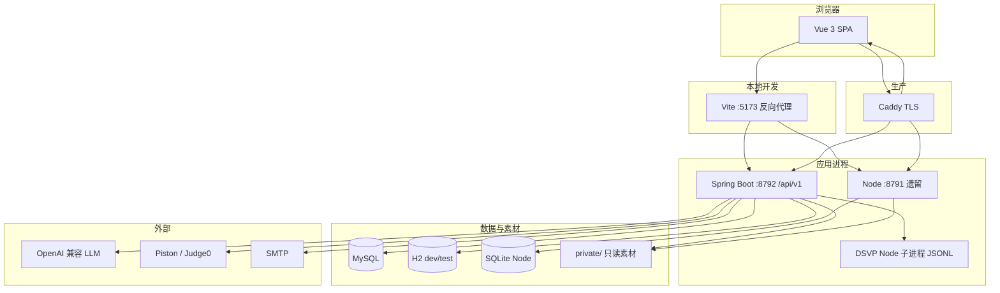

# 架构

## 产品形态（运行时）

Structify 是 **Vue SPA + Spring 模块化单体**；**Node 兼容层**与 **DSVP 子进程**并行存在，不是“Node 已被 Spring 整体替换”。

## 请求路由（开发 vs 生产）

### 本地（Vite）

`frontend/vite-routing.ts` 约定：

- **`/api/v1`** → Spring（8792）— **新前端默认 API**
- **`/api`**（非 v1）、`/presentation`、`/healthz`、`/pdfs`、`/vendor` → Node（8791）

更具体的 v1 路径必须写在 `/api/v1` 规则之前，避免被宽泛 `/api` 抢走。

### 生产（Caddy）

- `/api/v1/*` → Spring 容器  
- 遗留 `/api/*`、`/presentation/*` 等 → Node（迁移中）  
- 静态 SPA → `frontend/dist`  

细节：`deployment/Caddyfile.production`、`PRODUCTION_DEPLOYMENT_GUIDE.md`。

## 逻辑分层

| 层 | 职责 |
|----|------|
| **前端** | 路由、工作台 UI、调用 REST/SSE；`legacyApi` 桥接 Node 课件 |
| **Spring** | 认证、业务、持久化、编排 LLM、启动 DSVP、流式课件（presentation 包） |
| **Node** | 未迁移的旧路由、部分 presentation/PDF、healthz |
| **DSVP** | 确定性动画帧；模型只选能力与参数，**不生成逐帧** |
| **private/** | 教材 OCR、课件 PNG/WebP、源 PPT、PDF — **不进 Git** |

## 「AI 智能体」在本项目中的含义

不是 LangGraph / 多 Agent 平台，而是 **固定管道**：

1. **Chat / 代码分析**：`knowledge` 检索（关键词打分，内存）→ 提示词 → `ModelClient` 一次或 SSE。  
2. **课堂**：`ClassroomPreparation` 生成 JSON 脚本 → 契约校验 → `ClassroomTimeline` **状态机**推进；判答可走语义评估；动画步骤调用 DSVP。  
3. **动画实验室**：`animation-capabilities.js` 注册表（约 **167** 条）→ 模型选 capability → DSVP 模拟。

## 数据持久化

- **Spring**：Flyway 管理 MySQL/H2 表（用户、聊天、课堂会话、动画记录、审核队列、AI 配额、加密配置等）。  
- **Node**：SQLite（`better-sqlite3`），仅遗留路径仍读写。  
- **RAG**：审核通过的知识块在 DB；加载逻辑在 `knowledge` 包，**无独立向量数据库**。

## 安全边界（开发者须知）

- 用户 C/Python **从不**在 Spring 主机上 `ProcessBuilder` 执行。  
- 课件/资源路径：`realpath` + 包含校验，防目录穿越。  
- 无 `MODEL_API_KEY` 时 AI 接口 **fail-closed**（`MODEL_NOT_CONFIGURED`），不伪造回答。  
- 生产默认关闭调试泄露、静态提权、知识库 auto-publish。

## 新功能应落在哪

| 场景 | 首选 |
|------|------|
| 新 REST、新业务规则 | `backend/spring` 新/现有包 + Flyway 迁移 |
| 新页面、交互 | `frontend/src/<module>/` + `router` |
| 新动画能力 | `backend/dsvp/engine/` + Spring `animation` 适配 + 契约测试 |
| 仅旧客户端还在调的 API | 评估迁到 `/api/v1` 后下线 Node 路由 |

Node/Spring 差异表：[`docs/api-node-spring-differences.md`](../api-node-spring-differences.md)。
