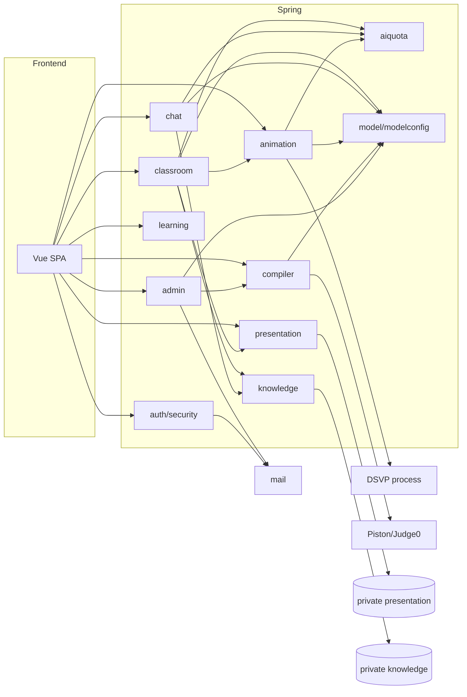

# 依赖关系

分 **外部运行时依赖** 与 **内部模块依赖**。部署拓扑见 [02-architecture.md](./02-architecture.md)。

## 外部依赖

| 依赖 | 用途 | 配置入口 | 缺失时典型行为 |
|------|------|----------|----------------|
| **MySQL 8.4** | Spring 生产持久化 | `DB_URL`, Flyway | 生产无法启动（未配置 JDBC） |
| **H2** | 本地 dev / 测试 | `dev` profile | 仅开发内存库 |
| **OpenAI 兼容 LLM** | 聊天、备课、动画规划、代码分析 | `MODEL_*` 或 admin 模型配置 | `MODEL_NOT_CONFIGURED` |
| **SMTP** | 注册/重置验证码 | `SMTP_*` 或 admin 邮件配置 | 发码失败；dev 可能有回显策略 |
| **Piston / Judge0** | 远程编译运行 | `PISTON_BASE_URL` / admin 沙箱 | 运行代码失败 |
| **`private/` 文件树** | 教材、课件、PDF、本地 runtime.properties | `KNOWLEDGE_DIR`, `RESOURCE_DIR`, presentation 路径 | RAG/课件/完整课堂不可用 |
| **Node 8791**（可选） | 遗留 API、部分 presentation | 根 `.env` → `backend/node/.env` | 仅影响非 v1 代理路径 |
| **DSVP 子进程** | 动画帧 | Spring 启动 Node 可执行路径 | 动画模拟失败；可能有 JVM 内兜底（通用九类结构） |

生产环境变量模板：`deployment/.env.spring.example` → `/etc/structify/structify.env`（0600）。

## 按功能的模块依赖（详述见 `modules/`）

| 功能 | 文档 | 主要依赖 |
|------|------|----------|
| 课堂 | [modules/classroom.md](./modules/classroom.md) | knowledge, presentation, animation(DSVP), aiquota |
| 动画 | [modules/animation.md](./modules/animation.md) | dsvp 进程, ClassroomModelJson(intent), aiquota(generate/interpret) |
| 编译器 | [modules/compiler.md](./modules/compiler.md) | Piston/Judge0, aiquota(analyze only) |
| 问答 | [modules/chat.md](./modules/chat.md) | knowledge, aiquota, animation(能力表) |

## 内部依赖（Spring 包级，逻辑方向）



说明：

- **`classroom`** 强依赖 **`knowledge`**（讲稿证据）、**`presentation`**（课件页）、**`animation`/DSVP**（步骤内动画）、**`model`**（备课/判答/插问）。  
- **`chat`** 依赖 **`knowledge`** 检索与 **`model`**；共用 **`aiquota`**。  
- **`animation`** 依赖 **DSVP**；LLM 仅用于 interpret/plan/generate 的语义部分。  
- **`compiler`** 只依赖远程 **沙箱** + 可选 **`model`**（analyze）。  
- **`learning`** 聚合各模块产生的事件，不反向阻塞业务。  
- **`admin`** 改配置影响 **`modelconfig`/`mail`/沙箱** 运行时源，优先于纯 env 默认值。

## 前端对后端的依赖

| 客户端 | 目标 | 场景 |
|--------|------|------|
| `api`（axios/fetch 封装） | Spring `/api/v1` | 默认全部新功能 |
| `legacyApi` | Node `/api`、`/presentation` | 课件签名 URL、未迁移路径 |
| Vite proxy | 8792 / 8791 | 仅 dev 同源 |

## Node 遗留栈（内部）

```
server.js → SQLite (DB_PATH)
         → 读取 private/ 下 presentation、pdfs
         → 旧 /api 路由表（见 api-node-spring-differences）
```

新功能**不应**新增 Node 对 SQLite 的耦合；应迁到 Spring + MySQL。

## 契约依赖

- 课堂脚本、动画 JSON → `contracts/*.schema.json`；变更需同步 Spring 校验与前端类型（如有）。  
- 公共 HTTP → `openapi-v1.yaml`；CI 与 `scripts/verify-*` 可能引用 fixtures。

## 私有素材依赖链（Full 环境）

```
import-knowledge-pack.ps1
  → private/knowledge/
  → KnowledgeCorpusLoader / DB chunks（审核后）

presentation-materials/
  → slides.json + PNG/WebP
  → PresentationCatalog（Spring）或 Node presentation 路由
```

无此链时，**功能仍在**，但课堂/问答/课件为空或 fail-closed — 见 [README.md](./README.md) Minimal 表。
