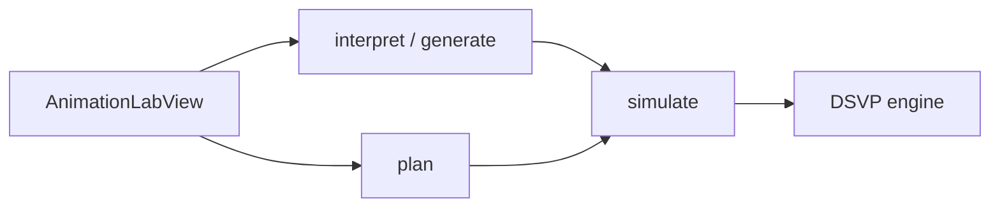

# 模块：动画学习

**路由：** `/animation`  
**产品含义：** 选择**结构 + 操作**（或自然语言描述意图）→ 得到 **DSVP 逐步可视化**；可播放/步进/倍速。与课堂共用同一套 DSVP 协议与引擎。

---

## 1. 两条用户路径

| 路径 | 用户操作 | 是否用 LLM | 典型 API |
|------|----------|------------|----------|
| **实验室选手势** | 从能力/catalog 选 capability + 参数 | **否**（`/plan` 纯引擎） | `POST /animations/plan` → `POST /animations/simulate` |
| **自然语言** | 输入一句话描述 | **是**（intent） | `POST /animations/interpret` 或 `POST /animations/generate` |
| **逐步播放** | 播放/暂停/上一步 | **否** | 反复 `POST /animations/simulate` |



---

## 2. 前端模块

| 文件 | 职责 |
|------|------|
| `animation/AnimationLabView.vue` | 实验室壳：章节、能力选择、自然语言输入 |
| `animation/AnimationStage.vue` | 控制区（结构/操作/播放） |
| `animation/AnimationPlayer.vue` | 帧渲染、键盘与播放控制 |
| `animation/useAnimationPlayback.ts` | 播放状态、请求 simulate |
| `animation/frame.ts` | 帧数据结构 |
| `animation/capability-catalog.json` | 前端能力展示（与引擎注册表应对齐） |
| `shared/types/contracts` | `DsvpRequest`、`DsvpSimulationResponse` 等 |

课堂内嵌播放：`classroom/ExperimentPanel.vue` → 同一 `AnimationPlayer`。

---

## 3. 后端 API

基路径：`/api/v1/animations`（两个 `@RestController` 共享前缀）

### 3.1 `AnimationController`

| 方法 | 路径 | LLM | 说明 |
|------|------|-----|------|
| POST | `/simulate` | 否 | **核心**：DSVP 一步/整链模拟；**不占 AI 配额**；有 `DsvpConcurrencyLimiter` |
| POST | `/generate` | 是 | 旧式「规划器 JSON」动画（`AnimationGenerationService`）；有 IP/用户 feature 限流 |
| POST | `/{id}/observations` | 否 | 学习观测记录 |

### 3.2 `AnimationIntentController`

| 方法 | 路径 | LLM | 说明 |
|------|------|-----|------|
| POST | `/interpret` | 通常 | 判断要不要动画、选 capability；优先 **本地引擎能力表** + 模型选参；无引擎时退回模型整包 request |
| POST | `/plan` | **否** | 已知 capability + arguments → 可执行 DSVP request（实验室点选路径） |

`interpret` 使用 **`ClassroomModelJson.generateFor(..., "animation-intent", ...)`**，与课堂共用 JSON 修复循环。

---

## 4. 后端子系统

### 4.1 编排与生成

| 类 | 职责 |
|----|------|
| `AnimationGenerationService` | `/generate`：LLM 输出 legacy JSON 动画定义 → `AnimationValidator` |
| `AnimationIntentController` | `/interpret`、`/plan`；章节 scope、confirmed/reply 语义（对接聊天里「好的」） |
| `AnimationRepository` / JDBC | 持久化 animation 记录（generate 路径） |

### 4.2 DSVP 执行层（非 AI）

| 类 | 职责 |
|----|------|
| `DsvpAnimationAdapter` | 请求 normalize、上下文 alias、调用引擎 |
| `DsvpLocalEngine` | 进程内或子进程 JSONL 调用 `backend/dsvp` |
| `DsvpSimulator` | 无引擎时的 JVM 侧兜底（九类通用结构） |
| `DsvpConcurrencyLimiter` | 并发闸 + 超时保护 |
| `DsvpModelContract` | 写入 prompt 的协议说明（课堂 ASK 也引用） |
| `AnimationValidator` | 白名单校验 generate 路径的 JSON |

### 4.3 引擎仓库 `backend/dsvp/`

| 路径 | 职责 |
|------|------|
| `dsvp-service.js` | 长驻服务入口 |
| `engine/animation-capabilities.js` | **167** 条能力、按章裁剪的 prompt 片段 |
| `engine/textbook-animation-engine.js` | 主模拟器 |
| `engine/dsvp-engine.js` | 协议与 trace |
| `test/verify-*.js` | 改引擎前必跑 |

原则（见 `backend/dsvp/README.md`）：**模型只选能力与参数，不生成逐帧**。

### 4.4 证据与观测

| 类 | 职责 |
|----|------|
| `DsvpEvidenceService` | simulate 时按来源（CLASSROOM / LAB 等）记 evidence |
| `AnimationObservationService` | 用户观测文本入库 |

---

## 5. AI 与配额

| 调用 | operation / 限流 |
|------|------------------|
| `/generate` | `AiQuotaExecution` + `ModelFeatureRateLimiter("animation")` |
| `/interpret` | `animation-intent` via `ClassroomModelJson` |
| `/simulate`, `/plan` | **无 token 配额**（本地计算） |

---

## 6. 与课堂、问答的交叉

- **课堂 `ASK`**：模型可返回 `animationRef`，同一 `DsvpAnimationAdapter.adapt` + simulate 播放。
- **课程问答**：回答末尾可邀请动画；确认后前端可走 `interpret`（`confirmed` / `reply` 字段），见 [chat.md](./chat.md)。

---

## 7. 调试入口

```bash
node backend/dsvp/test/verify-dsvp-engine.js
node backend/dsvp/test/verify-textbook-animation-coverage.js
```

Spring 测试：`backend/spring/.../animation/*Test.java`  
前端：`animation/*.spec.ts`
