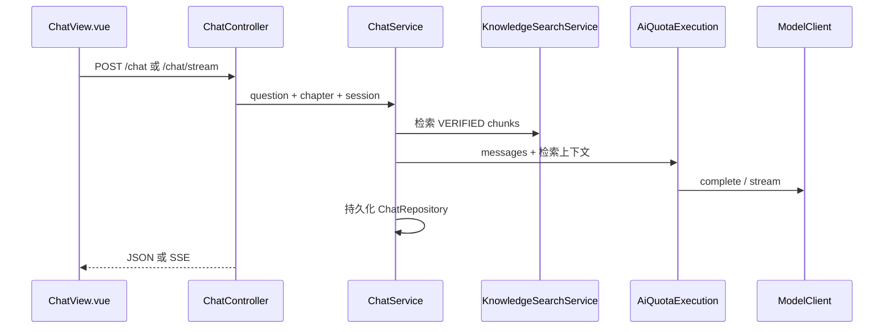

# 模块：课程问答

**路由：** `/chat`  
**产品含义：** 针对**当前课程/章节**的教材 grounded 问答；支持**流式**回复、会话历史；可在回答中**邀请**跳转动画（与动画实验室 `interpret` 衔接）。

---

## 1. 请求流水线

**检索：** `knowledge` 包内关键词/受众过滤 — **不是**向量数据库。

---

## 2. 前端模块

| 文件 | 职责 |
|------|------|
| `user/views/ChatView.vue` | 聊天 UI、章节选择、流式展示 |
| `user/chat-stream.ts` | SSE 解析、断线/abort |
| `user/api.ts` | `/chat`、`/chat/stream`、sessions CRUD |
| `user/runtime.ts` | `userApi` |
| `user/components/AnimationDialog.vue` | 回答中邀请动画时的确认 UI → 调 animations interpret |

旧 `/user/*` 路由已 **redirect 到 `/`**（`user/routes.ts`），问答入口固定 **`/chat`**。

---

## 3. 后端 API

控制器：`chat/ChatController` → `/api/v1/chat`

| 方法 | 路径 | 说明 |
|------|------|------|
| POST | `/chat` | 同步问答 |
| POST | `/chat/stream` | SSE 流式（带 watchdog 防挂死） |
| GET/POST/DELETE | `/chat/sessions`… | 会话与历史（登录用户） |

OpenAPI：`contracts/openapi-v1.yaml` 中 `chat` 段。

---

## 4. 后端子系统

### 4.1 `ChatService`（核心）

| 步骤 | 实现要点 |
|------|----------|
| 检索 | `KnowledgeSearchService.search`，受众 `KnowledgeAudience` |
| 提示词 | 固定 `SYSTEM_PROMPT`：简洁、**禁止**在正文里写「根据教材第 X 页」 |
| 动画邀请 | 按章节缓存 DSVP 能力列表，追加 `ANIMATION_PROMPT` 约束「只邀请清单内操作」 |
| 历史 | 最近 **12** 条 user/assistant 进 context |
| 调用 | `AiQuotaExecution.complete` / `stream`；operation 名与 chat 功能相关 |
| 持久化 | `ChatRepository` / JDBC；附件见 Flyway `V26`–`V28`、`V29` pin |

### 4.2 支撑类

| 类 | 职责 |
|----|------|
| `ChatHistoryService` | 历史组装 |
| `ChatRateLimiter` | 防滥用 |
| `ChatAttachmentStorage` | 附件文件（若启用） |
| `ChatEvidenceFingerprint` | 检索证据指纹 |
| `PendingChat` / `ChatRetry` | 流式与重试上下文 |

### 4.3 与动画的衔接

- 模型在回答末尾**仅用自然语言邀请**动画；用户确认后前端调用 **`POST /animations/interpret`**，带 `confirmed: true` 与 `reply`（见 `AnimationIntentController.Input`）。
- 能力列表来源：`DsvpLocalEngine` / 章节 capability prompt（与动画模块共用）。

---

## 5. AI 与配额

- 所有正式生成走 **`AiQuotaExecutionService`**（与课堂、代码分析共用**日配额账本**）。
- 未配置模型：`ModelGenerationReadiness` → `MODEL_NOT_CONFIGURED`。
- 流式 abort：`AiStreamAbortedException`（Controller 层处理）。

---

## 6. 依赖包

| 包 | 用途 |
|----|------|
| `knowledge` | 检索与 chunk  eligibility |
| `model` / `modelconfig` | LLM 客户端 |
| `aiquota` | 配额预留与结算 |
| `animation` | 能力 catalog（`DsvpLocalEngine`）供 prompt 追加 |
| `learning` | 可选学习事件 |

---

## 7. 调试

- 单测：`backend/spring/.../chat/*Test.java`
- 前端：`user/views/ChatView.spec.ts`、`user/chat-stream.spec.ts`
- Full 环境：需 VERIFIED 知识块 + `MODEL_API_KEY` 才有实质回答
