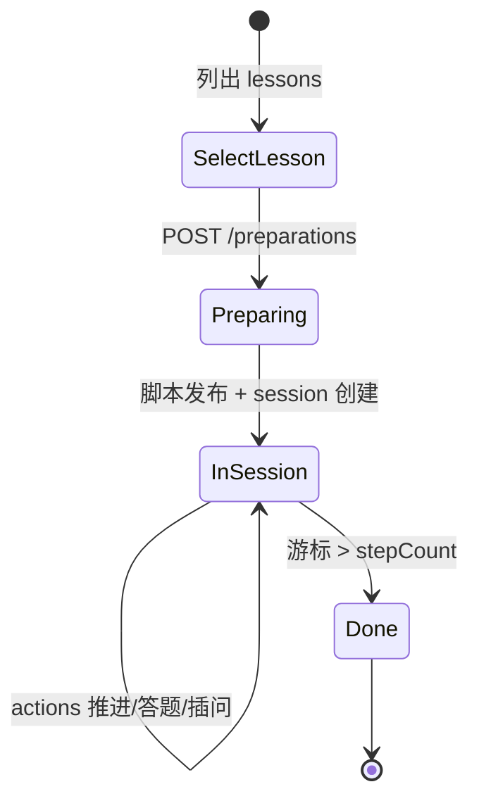

# 模块：课堂

**路由：** `/classroom`  
**产品含义：** 选一课已核验教材 → **后台备课**生成逐步脚本 → **会话**里按游标讲课、提问、判答，右侧同步课件。

---

## 1. 生命周期（两阶段）

| 阶段 | 用户可见 | 后端核心 |
|------|----------|----------|
| **选课** | 课时列表、章节 | `ClassroomPreparation.lessons()` |
| **备课** | 「正在生成…」轮询 | `ClassroomPreparation.start()` 异步 job |
| **上课** | 讲稿、提问、课件、动画区 | `ClassroomTimeline` + `ClassroomService` |

---

## 2. 前端模块

| 文件 | 职责 |
|------|------|
| `classroom/ClassroomView.vue` | 主 UI：选课、preparation 轮询、session、输入框、主按钮（继续/再答/插问） |
| `classroom/SlidePanel.vue` | 右侧课件页、翻页、`slideMatch` 徽标 |
| `classroom/ExperimentPanel.vue` | 步内 DSVP 动画展示 |
| `classroom/preparation-poll.ts` | 备课状态退避轮询间隔 |
| `animation/AnimationPlayer.vue` | 播放器（课堂复用） |
| `user/api.ts` | 课堂 REST 封装（`ClassroomLesson`、`ClassroomPreparationStatus` 等） |
| `user/runtime.ts` | `userApi` 实例 |

本地存储：`structify.classroom.last` 保存最近 session id（**不会自动续课**，需用户选择）。

---

## 3. 后端 API（Spring）

控制器：`classroom/ClassroomController` → `/api/v1/classroom`

| 方法 | 路径 | 作用 |
|------|------|------|
| GET | `/lessons` | 可选课时（来自 VERIFIED 教材 chunk） |
| POST | `/preparations` | 启动备课 job |
| GET | `/preparations/{id}` | 轮询备课状态 |
| GET | `/scripts` | 已发布脚本列表（按章） |
| POST | `/sessions` | 用 scriptId 创建会话 |
| GET | `/sessions/{id}` | 当前 stage（含 slideRefs、判答结果） |
| POST | `/sessions/{id}/actions` | `CONTINUE` / `ANSWER` / `ASK` / `HINT` / `SKIP` / … |
| PUT | `/sessions/{id}/slides` | 教师指定某步课件页（override） |

契约：`contracts/classroom-script.schema.json`、OpenAPI `classroom` 段。

---

## 4. 后端子系统（按职责）

### 4.1 备课 `ClassroomPreparation`

- 输入：`knowledge` 库中 **VERIFIED** 教材 + `presentation` 课件页序（有课件时 **课件为讲解主线**）。
- 模式：`app.classroom.slide-narration` = **`model`**（默认，LLM 写每页讲稿）或 **`deterministic`**（本地 `SlideSpinePlan`，**不调模型**）。
- 输出：通过 `ClassroomScriptParser` 校验的 JSON → 写入 DB 并创建 session。
- 失败兜底：某段模型多次校验失败时，可用 **本地课件脊线** 补齐该段（不重复计费整课失败）。
- 线程：专用 `classroom-prep-*` 平台线程池（长链阻塞 LLM + DB）。

相关类：`SlideSpinePlan`、`ClassroomScriptPlan`、`LessonPassageIndex`、`TextbookLessonIds`。

### 4.2 脚本契约 `ClassroomScriptParser`

- 校验 `steps[]`：类型（explain / question / summary…）、`slideRefs`、`questionSource`、页序等。
- **服务端派生** `slideScope`（模型不必手抄），减少契约拒收。

### 4.3 运行时 `ClassroomTimeline` + `ClassroomService`

- **`runtime_index`**：当前第几步；**`runtime_revision`**：乐观锁。
- **`runtime_response`**：当前步上的插问/作答/提示 JSON（含 `answered`、`retry`）。
- **推进步骤**：`CONTINUE` 只移动游标，**不调 LLM**。
- **课件对齐**：`ClassroomSlideAlignment`（人工 pin > 脚本 slideRefs > 自动对齐）。

### 4.4 步内状态 `ClassroomStateMachine`

- 状态：`OPENING` → `EXPLAIN` → `QUESTION` → `WAITING` → `DISCUSS` / `BLACKBOARD` → `SUMMARY`。
- **只处理合法 action 转移**；**不含** LLM。

### 4.5 课堂内 AI `ClassroomModelJson`

所有「要 JSON 的」课堂 LLM 调用统一入口：

| 调用场景 | 触发 action / 阶段 | Quota `operation` |
|----------|-------------------|-------------------|
| 备课生成脚本 | `ClassroomPreparation` | `classroom` |
| 学生作答判分 | `ANSWER` | `classroom` |
| 插问 | `ASK` | `classroom` |
| 提示 | `HINT` | `classroom` |
| 跳过并讲解 | `SKIP` | `classroom` |

机制：最多 **3 轮**「生成 → 校验 → 把错误写回 messages 重试」。底层：`AiQuotaExecution.complete()` → `ModelClient`。

插问/判答时若带 `animationRef`，经 `DsvpAnimationAdapter.adapt()` 校验（**帧仍由 DSVP 算**）。

### 4.6 持久化 `ClassroomRepository` / JDBC

- 脚本、会话、`runtime_*` 字段、slide override（Flyway 含 `V25__classroom_slide_overrides` 等）。

### 4.7 依赖的其他包

| 包 | 用途 |
|----|------|
| `presentation` | 课件 deck、slide 元数据与图片 |
| `knowledge` | 课时列表、备课证据、检索 |
| `animation` | `DsvpAnimationAdapter`、能力规则注入 prompt |
| `learning` | `CLASSROOM_ANSWER` / `CLASSROOM_SKIP` 等事件 |

---

## 5. 关键语义（改代码前必读）

1. **答错不前进**：`ANSWER` 判为 INCORRECT/MISCONCEPTION 时保持 `WAITING`，`retry: true`（见 `ClassroomTimeline`）。
2. **SUMMARY 步 ≠ 整课结束**：只有 **游标 ≥ stepCount** 才算下课（前后端一致）。
3. **提问步不消耗课件页游标**：教学步按页推进，question 步复用当前页。
4. **模型不能移动游标**：LLM 输出只写入 `runtime_response`，`CONTINUE` 才前进。

---

## 6. 调试入口

| 目的 | 命令/位置 |
|------|-----------|
| 包内单测 | `backend/spring/.../classroom/*Test.java` |
| 端到端脚本 | `scripts/verify-slide-spine.mjs` 等（需 Full 环境） |
| 配置 | `app.classroom.slide-narration`、`app.classroom.skip-limit` |
