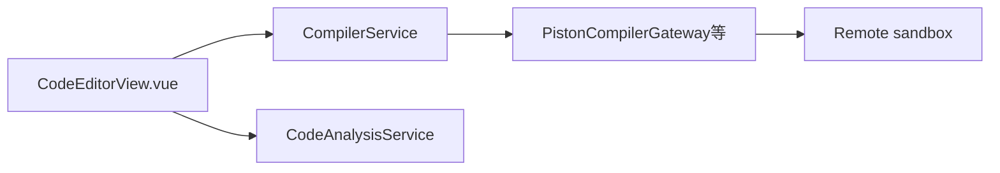

# 模块：C 编辑器

**路由：** `/compiler`  
**产品含义：** 编辑并**远程运行** C / Python（沙箱），可选 **AI 分析**运行结果；**允许游客**使用运行接口（按 IP 限流）。

---

## 1. 能力拆分

| 能力 | 是否 LLM | 说明 |
|------|----------|------|
| **运行代码** | 否 | Piston 或 Judge0 远程编译执行 |
| **AI 分析** | 是 | 根据源码 + stdin/stdout/ stderr 文本分析，**不在服务端执行用户代码** |
| **交互式会话** | 否 | 长运行/ stdin 流（SSE） |
| **教材样例库** | 否 | 按章节的代码片段（可给课堂用） |

---

## 2. 前端模块

| 文件 | 职责 |
|------|------|
| `compiler/CodeEditorView.vue` | 编辑器 UI、运行、分析、语言切换 |
| `compiler/templates.ts` | 默认代码模板 |
| `shared/api` 或内联 fetch | 调用 `/api/v1/code/*` |

路由：`router/index.ts` 中 **`requiresAuth` 未强制**（游客可进）。

---

## 3. 后端 API

基路径：`/api/v1/code`（多个 Controller）

### 3.1 `CompilerController`

| 方法 | 路径 | 认证 | 说明 |
|------|------|------|------|
| POST | `/runs` | 可选 | 主运行接口 |
| POST | `/run` | 可选 | 兼容别名（deprecated） |

限流：`WindowRateLimiter` 60/min + `CompilerConcurrencyLimiter`（按 user 或 IP key）。

### 3.2 `CodeAnalysisController`

| 方法 | 路径 | 认证 | 说明 |
|------|------|------|------|
| POST | `/analyze` | 通常需登录 | `CodeAnalysisService` → `AiQuotaExecution` |

### 3.3 `CodeSessionController`

| 方法 | 路径 | 说明 |
|------|------|------|
| POST | `/sessions` | 创建交互会话 |
| GET | `/sessions/{id}/stream` | SSE 输出 |
| POST | `/sessions/{id}/stdin` | 写入 stdin |

### 3.4 `ClassroomCodeController`

| 方法 | 路径 | 说明 |
|------|------|------|
| GET | `/samples` | 课堂相关样例 |
| GET | `/library` | 教材代码库索引 |

管理端沙箱配置：`SandboxConfigController` → `/api/v1/admin/sandbox-config`（非本页用户路径）。

---

## 4. 后端子系统

### 4.1 运行 `CompilerService` + `CompilerGateway`

| 类 | 职责 |
|----|------|
| `CompilerService` | 校验语言、输入输出上限、调用 gateway、记 `CodeRunRepository` |
| `PistonCompilerGateway` | HTTP 调 Piston |
| （Judge0） | 由 `SandboxProvider` / 配置选择 |
| `CompilerExecution` | 单次执行封装 |
| `SupportedLanguage` | C、Python 等枚举 |
| `CompilerProperties` | 超时、长度限制 |

**安全：** Spring 主机上**不** `ProcessBuilder` 用户代码；只调远程沙箱。

### 4.2 分析 `CodeAnalysisService`

- System prompt：定位问题、原因、修复建议、复杂度。
- 输入：用户代码 + 运行状态（success / compile_error / …）+ 输出摘录。
- 通过 **`AiQuotaExecution`** 计费；可写 `learning` 事件。

### 4.3 沙箱配置

| 类 | 职责 |
|----|------|
| `SandboxConfigService` | DB 持久化 provider + URL（优先于 env） |
| `SandboxConfigRepository` | Flyway `V22__add_sandbox_configuration` |
| `SandboxConnectionTester` | 管理端「测试连接」 |

环境变量：`PISTON_BASE_URL`、`JUDGE0_BASE_URL`（见 `backend/spring/README.md`）。

### 4.4 教材代码目录

| 类 | 职责 |
|----|------|
| `TextbookCodeLibrary` | 聚合章节代码片段 |
| `ClassroomCodeCatalog` | 课堂用样例 |

---

## 5. 依赖

| 外部 | 内部包 |
|------|--------|
| Piston / Judge0 HTTP | `compiler` |
| LLM（仅 analyze） | `model`, `aiquota` |
| — | `learning`（可选事件） |

---

## 6. 调试

- 单测：`backend/spring/.../compiler/*Test.java`
- 前端：`compiler/CodeEditorView.spec.ts`
- 无沙箱 URL 时：运行失败；分析仍可能因无 `MODEL_API_KEY` 失败
