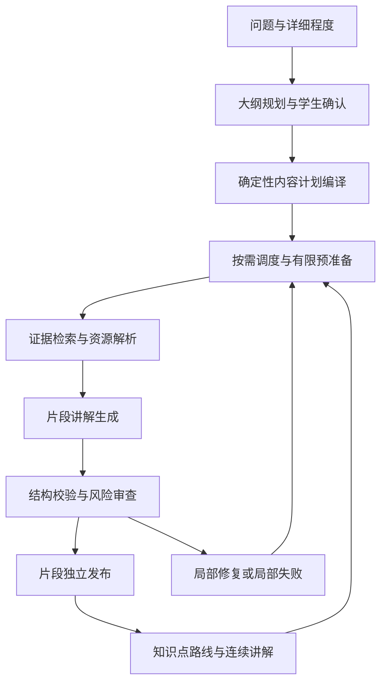

# 学习教室简化与渐进生成设计

日期：2026-10-18

状态：交互方向已确认；本文待整体审阅。本文描述目标设计，不代表功能已经实现。

范围修订：项目尚未上线，按用户最新要求只保留一条片段生成链，删除旧生成设计和模块内冗余代码，不实现旧课堂适配、双链分流或兼容开关。学习路线修订、并发和异步响应的版本隔离仍然保留。

## 1. 已确认的产品决策

1. 学生只面对一层知识点路线；后台步骤作为知识点内部的讲解过程。
2. 保留 QUICK / STANDARD / DEEP 三档，以及先生成大纲、学生审阅修改、确认后生成正文的流程。
3. 首个可学习片段优先生成；学生阅读时准备后续内容。
4. 首段通过检查后自动进入课堂；只在学生仍位于相应大纲准备页时自动跳转。
5. 已通过检查的片段独立发布；后续失败不撤回已有内容，重试只针对失败片段。
6. PPT、动画、代码按教学需要出现，不为每段强行凑齐资源类型。

## 2. 问题证据与边界

当前课堂 d1d1fbca-2d4e-416b-9fd6-5e363bc03e2d 包含四个单元、22 个步骤，分别为 6、5、6、5 步。
页面同时提供单元导航和步骤导航；点击单元还可能触发生成或重试，导航与任务操作混在一起。

现有调用链包含大纲规划、单元步骤规划、逐步内容生成和逐步模型审查。按该课堂规模，在无缓存、修复和重试时，理论上需要约 49 次调用；这不是实测调用账单。
运行日志存在 JSON 封装解析、资源候选校验、模型教学审查失败。现有日志缺少完整的结构化问题记录，不能据此给出总体失败率，也不能把所有教学审查失败认定为误判。

现有系统逐步保存检查点，但整个单元通过后才发布，导致保存成功不等于学生可以阅读。

本次保留现有数据库任务、租约、幂等、配额、资源授权和大纲版本机制，重点调整规划边界、发布粒度、调度和交互。
不引入新的通用 Agent 框架，不开发掌握度预测，不在本次接入新的代码沙箱，不重建课件素材库。

## 3. 统一概念

- 学习路线：学生已确认的全部知识点及范围，对应一个 run。
- 知识点：唯一的学生导航层级；数据库暂时保留 unit 命名，避免无必要的全库重命名。
- 学习片段：知识点内部可独立阅读、检查、发布和恢复的最小内容，后端称 fragment。
- 资源场景：片段内的文字、PPT 页组、动画、代码或理解检查，不构成另一套主导航。

“完成学习”与“生成就绪”必须分开。生成完成不能被记为学生学完；前进按钮只记录浏览进度，不能声称学生已经掌握。

## 4. 学生流程

### 4.1 大纲审阅和进入

三档详细程度主要改变解释深度、例子、边界和练习量，不靠机械增加知识点数量体现深度。
大纲展示知识点目标和必要的过程、代码、练习活动；允许展开查看内部讲解安排，不提供第二套学习导航。

确认请求幂等地创建 run、冻结内容计划并排队首片段。页面展示真实的阶段状态，例如排队、准备首段、检查材料；不展示虚构百分比。
首片段 READY 后进入课堂，不等待后续内容完成。失败时留在准备页，显示明确恢复操作。

自动进入条件必须同时满足：页面仍挂载、当前 draft/revision/run 与确认结果匹配、用户未取消等待或主动离开。
页面卸载或版本变化后取消旧轮询和跳转意图；旧响应不能覆盖新页面，也不能触发跨页面跳转。
直接打开课堂 URL 时可展示准备状态，不强制退回大纲。

### 4.2 课堂

唯一的主导航是知识点路线；主区域显示当前知识点中已就绪的讲解与必要资源。
“继续学习”推进到下一个片段；可回看前面内容，不再展示独立步骤标签栏。
未就绪片段以简短准备状态占位，不把未检查的模型输出当作正式内容。
知识点进度以学生最后浏览的片段和明确的完成动作记录，跨会话恢复。

切换知识点只改变选择状态。客户端可同时发送幂等的学习焦点通知，以便后台调整优先级；不会隐式重试失败内容。
失败位置提供独立的“重新准备”操作，并说明哪些内容已可阅读。失败信息不覆盖主区域里已经就绪的讲解。
保留查看已确认大纲、修改学习路线和结合当前材料追问的入口。

## 5. 目标架构和职责

- OutlineService：管理问题范围、大纲版本、审阅和确认。
- ContentPlanCompiler：把已确认知识点及活动编译为稳定片段计划；不再次调用模型自由规划整套步骤。
- PreparationScheduler：根据确认、焦点和继续学习事件维护有界准备窗口及任务优先级。
- EvidenceResolver / ResourceResolver：按当前子目标检索依据、匹配资源、验证可用性，生成不可由模型伪造的绑定。
- FragmentComposer：围绕一个冻结的子目标生成讲解，不拥有发布和调度权限。
- FragmentValidator：执行结构与资源硬检查，按风险组织教学审查，输出结构化问题。
- FragmentPublicationService：在事务中校验当前 run 和有效租约，幂等发布一个片段。
- ReadModel：组合知识点、片段可读性和学生浏览进度，向前端屏蔽内部任务结构。

首期仍使用 Spring Boot、JDBC、现有数据库队列和 Vue，按职责拆分现有 Composer/PublicationService，无需引入新的消息中间件。

## 6. 内容计划算法

大纲规划仍由模型结合授权依据完成；结构和范围校验仍由程序执行。
在学生审阅阶段，按活动模板生成可预览的片段安排，确认时冻结为持久化计划。

基础活动映射为：概念解释、过程演示、代码阅读、运行实验、理解检查。
每个片段只有一个主要子目标和一种主活动。一个目标可包含多页 PPT；页数不等于步骤数。
过程较复杂时，以已确认的操作对象生成必要片段，例如入栈和出栈分别演示，不额外加入整章前置复习。
同一子目标重复的引入与解释合并；必要的分解结果在确认前即可查看，确认后不新增未批准的实验或知识范围。

片段键由知识点稳定键、活动、子目标键和计划版本确定，不能使用模型临时生成的随机序号作为跨重试身份。
计划上限由深度与活动模板配置，达到上限时在审阅阶段要求缩小或拆分知识点；不能在正文生成阶段悄悄截断已确认目标。
变更深度或范围生成新大纲修订和新 run；旧任务禁止向新 run 发布。

## 7. 资源与讲解生成算法

1. 检索查询包含问题范围、知识点目标和当前片段子目标，按授权和章节过滤。
2. 以当前子目标相关性为主，原问题为辅助。首期复用关键词检索；保留同一来源中的多个不同相关片段，再按重复内容和页码去重，防止来源去重过度丢失依据。
3. 资源匹配先应用活动类型、权限、实际存在性和运行能力的硬约束，再排序；每种资源保留少量候选。
4. 程序分配短候选键，并持有候选键到真实资源 ID、PPT 页组、代码范围、动画参数的映射。
5. 模型输出讲解、证据候选键和场景选择；不得输出任意真实资源路径或任意动画 API 参数。
6. 程序解析候选键，组装既有前端场景协议并执行校验。模型选了不存在的键仍视为错误，不能猜测替换。

优先使用模型供应方已支持的结构化输出能力，并保留本地 schema 校验；不假定当前接口支持强制 JSON Schema。
可确定的字段默认值和封装清理由程序处理，不能自动补写被截断的正文或伪造证据。

已确认的 REQUIRED 资源缺失时阻断相关片段并提示修正资源或大纲。可选资源可以省略；推荐资源可用有依据的文字解释替代，但必须记录降级原因。
没有沙箱时仍可阅读、编辑 C 代码，不能产生虚构运行结果。明确要求运行的活动在审阅阶段提示能力缺失。

## 8. 调度与预准备算法

默认准备窗口为“当前知识点全部必要片段 + 下一知识点首片段”，不自动准备整个路线。
学生确认、切换知识点、推进片段、任务完成或恢复时重新计算需求，并按以下顺序排队：

1. 学生正在等待的片段，包括显式局部重试。
2. 当前知识点中紧随浏览位置的必要片段。
3. 下一知识点的首片段。

同优先级按路线顺序和入队时间排序；同一用户仍遵守现有模型并发限制，不通过预准备绕过配额。
焦点跳转后，尚未执行的旧预准备任务降级或撤销需求；正在执行的调用允许完成并保留结果，不强行中断后自动重复计费。
已就绪结果不会因移出准备窗口被删除。焦点事件需去重和节流，不能每次轮询创建任务。
完成当前知识点后窗口向前移动；停止阅读后不跨窗口无限扩张。多用户调度应避免一个用户的预准备占满全局工作槽。

## 9. 状态与持久化

新增 fragment 记录：run_id、unit_id、fragment_key、order、plan_json、content_json、status、content_revision、plan_hash、resource_revision、error_code、issues_json、发布版本和时间。
唯一约束为 (run_id, unit_id, fragment_key)。生成任务增加 fragment_id 和 priority；每个片段至多有一个有效生成任务。
新增按用户、run、知识点记录的浏览位置，不能以生成状态推断学习进度。

片段状态：PENDING → QUEUED → GENERATING → READY；失败进入 FAILED，可显式重试。
发布以片段 READY 为准，知识点状态由片段聚合为 PREPARING、PARTIAL、READY 或 NEEDS_ATTENTION；已有可读内容和后续失败可同时成立。
前端以 readableFragmentCount、hasPendingContent、failedFragmentCount 等字段显示状态，不依赖一个互斥标签表达所有情况。

幂等身份包含 run、fragment_key 和内容修订。每次显式重试保留相同业务片段、增加尝试号；修复失败不能清空其他片段。
发布事务验证有效租约、当前 run、计划版本和片段状态；重复发布返回已有结果，不重复插入步骤。
已有内容需要重生成时，旧 READY 修订保持可读，新修订通过后原子替换。
跨 run 复用必须同时匹配计划、依据、资源版本、权限和生成协议版本，不能仅凭相同问题复用。

## 10. 校验和失败恢复

硬检查始终执行：JSON/schema、必填字段、授权资源、代码行号、动画参数、证据存在性、必要活动和当前版本。
理解检查的答案及解释也需要依据支持，不能只因格式合法就直接发布。

高风险片段执行模型教学审查：代码含义、实验、算法状态变化、复杂度和边界结论。普通概念片段执行规则检查与采样审查；采样不是承诺每个概念均已由模型复核。
审查返回 severity、code、message、evidenceKeys 和修复位置，区分实质性错误与表达建议。只含表达建议不阻断。
代码结论不符、错误算法过程、无依据的关键结论和虚构运行结果均阻断；审查不确定时不得按通过处理，高风险内容保持待处理。

每个片段最多一次模型内容修复，修复后重新执行对应硬检查和必要审查；耗尽预算后等待显式重试。
网络瞬态失败只在能够确认请求尚未发送时自动退避重试；模型调用结果不确定时沿用 SENT 防重机制，不自动再次花费 Token。
配额不足或并发冲突单独分类；并发冲突可等待槽位，日额度不足暂停后续准备并提示恢复条件。

持久化记录失败阶段、错误码、尝试号、结构化问题、调用关联、可恢复性；前端显示适合学生的摘要。
日志保留关联 ID 和必要摘要，不输出密钥或完整私人上下文。

## 11. API 与前端技术路径

确认大纲接口保留 roomId/runId 返回值，新增准备状态；GET run 增加知识点聚合、片段和首段就绪信息。
新增幂等的 run 学习焦点接口、片段重试接口及浏览进度接口；所有写操作验证归属和当前 run。
删除原 unit prepare 接口和对应前端调用，准备需求统一由学习焦点驱动，失败片段使用独立重试接口。

首期沿用轮询：准备页与课堂仅在有待处理任务时轮询，后台页面降频，卸载后停止。服务端返回状态版本供客户端丢弃过期响应；暂不新增 SSE。
StudyroomOutlineView 处理确认等待和受条件保护的自动进入；StudyroomView 改为单层路线和片段讲解，资源组件继续复用。
outline-runtime 和共享类型加入片段协议；OpenAPI 同步记录状态、空值含义和错误分类。

## 12. 旧实现清理与交付顺序

不适配现有开发课堂。实施时停止相关 Worker，备份后清除本模块的开发课堂、大纲、片段和生成任务数据，再按新流程重新创建课堂；用户、认证、模型配置、配额账本和课程素材保持独立，不随本模块清理。
删除 StudyroomUnitPlanner、StudyroomUnitComposer、单元整体发布链和其独有的校验策略、测试及文档。引用检查后再删除旧图编排、直接创建课堂、mock 运行分支；仍被其他有效功能调用的通用能力先提取再移除旧调用者。
不新增 generation_version、旧步骤投影或双版本功能开关。任务只保留大纲与片段生成；删除 UNIT 任务分支和过时 API。
数据库仍使用可审计的 Flyway 迁移；移除不再使用的表列、约束和索引时同步更新查询与测试，不以整个项目数据库重置代替模块清理。

阶段一：片段协议、单层导航、独立重试交互和错误观测。
阶段二：冻结计划编译、片段任务、局部发布、准备窗口和自动进入条件。
阶段三：资源绑定收敛、分级教学审查和代表性问题回归。
各阶段不能宣称已解决后续阶段的生成稳定性问题。

## 13. 验证与验收

- 确认大纲后只准备有界窗口，首段就绪即进入；主动离开、旧修订完成和乱序响应均不触发错误跳转。
- 课堂仅有一层知识点导航；前进、回看、跨知识点跳转和刷新恢复均可用。
- 一个片段失败时，已发布内容可读；重试不改写其他片段、不重复扣费或重复发布。
- 并发请求、租约过期、旧 Worker 回写、跨用户访问和重复确认不能破坏 run/fragment 边界。
- 必需资源缺失可定位；可选资源缺失不导致整知识点失败；没有运行能力时不假装执行成功。
- 普通用户限额仍生效；开发测试账号已有特殊配额政策不因本次重构改变。
- 代码库不存在旧单元生成入口、兼容投影与双链开关；新课堂可从审阅到局部恢复完整运行。

回归样本至少包含：栈知识总览、单独入栈、顺序栈与链栈比较、二叉树遍历、C 代码阅读、无沙箱运行请求，以及无相关资料和资源损坏场景。
三档分别验证范围不膨胀、必要活动不丢失、资源不强行齐全。

观测首片段耗时、片段首轮通过率、局部修复恢复率、模型审查阻断原因、每个已发布片段调用数/Token 和预准备未阅读量。
先固定模型配置、课程资源版本和样本取得旧链基线，再与新版比较；无实测前不承诺具体速度或失败率改善百分比。
验收要求：核心功能与恢复用例全部通过；相同样本的总体首段耗时及平均调用量低于旧链，实质性教学错误不增加。存在随机性时报告样本量与原始结果，不以单次成功证明稳定。

## 14. 自审结论

本文已区分学生概念与数据库命名、浏览进度与生成进度、局部发布与整知识点完成、推荐资源降级与必要资源阻断。
自动进入包含页面与版本约束；后台准备有明确边界；恢复保留现有防重计费和旧 run 写入隔离。
具体类名和新接口字段属于拟定技术路径，实施前需写入实施计划并与当前代码核对。整体文档审阅通过后进入实施计划阶段。
