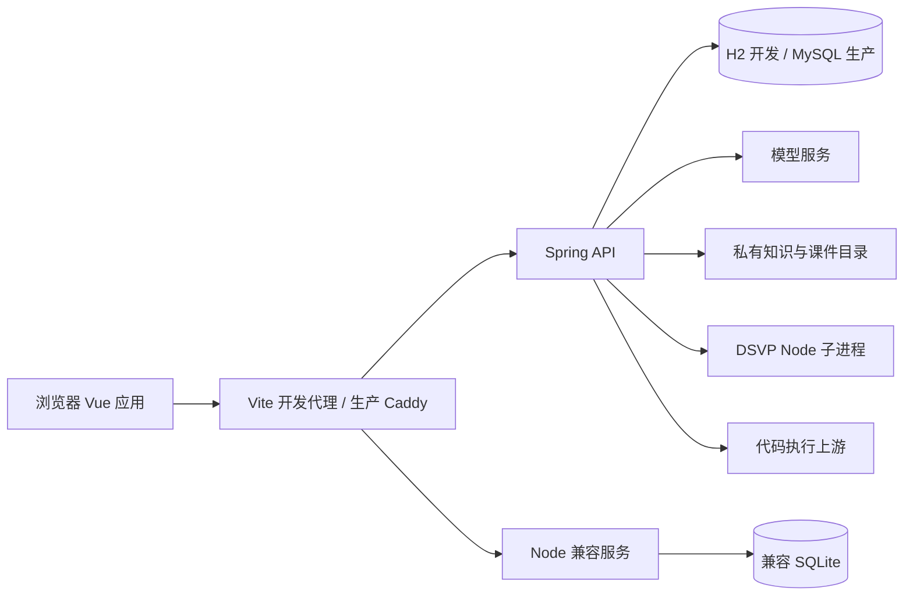
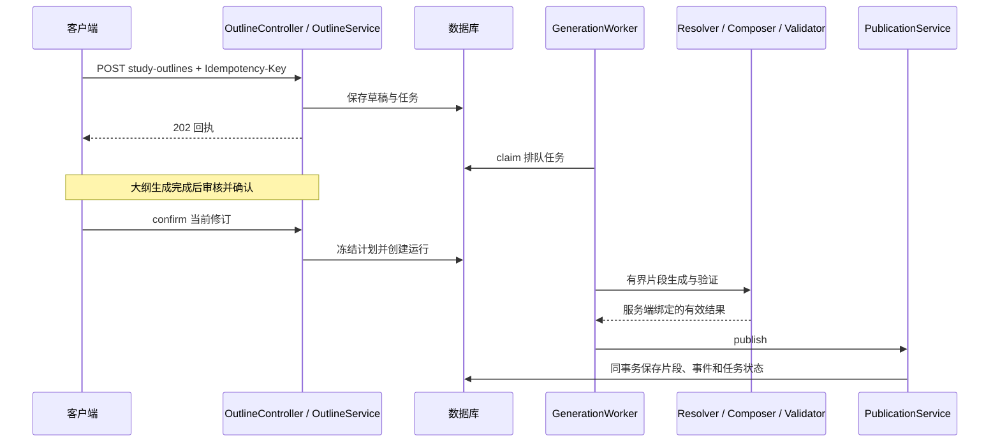

# 系统架构

基线：2026-10-24 工作区。以下图是已核对源码结构的抽象，不意味着已执行端到端验证。当前学习室细节以[状态说明](architecture/studyroom.md)为专项来源；决策原因见[后端 ADR](adr/backend/阅读指南.md)；Node 与 Spring 并存边界见[兼容差异](architecture/node-spring-compat.md)。

## 服务与依赖方向

Vue 入口 [main.ts](../frontend/src/main.ts) 挂载 App 并注册 [router/index.ts](../frontend/src/router/index.ts)。开发代理由 [vite-routing.ts](../frontend/vite-routing.ts) 按路径分流，不能理解为所有 API 都进 Spring。Spring 入口是 [DsAgentServerApplication](../backend/spring/src/main/java/com/feng/dsagent/DsAgentServerApplication.java)。生产入口与服务关系来自 Compose/Caddy；Node 的存在是兼容边界，并非另一个学习室生成器。

Spring 包按业务划分，Controller 承接认证主体与请求，Service 协调业务；持久化访问层规范为 MyBatis Mapper + XML（既有 JdbcTemplate / `Jdbc*` 为遗留）。**权威状态在 MySQL**；知识检索当前为库内词法/eligibility 快照，不以外部向量库为生产依赖；课件二进制当前在私有目录，对象存储为规划演进而非已部署事实。分层、数据面选型与禁止事项见[后端工程规范](architecture/backend-standards.md)。不是所有包都严格采用同一分层，修改前应追踪实际调用，不以架构图替代源码。

## 链路一：审核大纲到片段发布

[OutlineController](../backend/spring/src/main/java/com/feng/dsagent/studyroom/draft/OutlineController.java) 暴露创建、AI 修订、手工修订和确认；手工修订同步返回，不能把全部大纲操作都描述为模型异步调用。确认后的 PreparationScheduler 只调度有限窗口。资源选择在模型前受限，生成输出经校验后才能发布。旧 run、pending revision 和 lease 失效均可能阻断写入。完整算法和故障语义见三篇核心 ADR，本页不重复预算值。

## 链路二：事件读取与课堂追问

ClassroomEventController/Service 读取持久事件与快照。SSE 重连负责恢复已提交状态，不触发模型。ClassroomQuestionService 冻结问题上下文并创建独立 FOLLOWUP；ClassroomQuestionWorker 执行并发布答案。追问失败不应改变源课文，生成内容、阅读进度、测验成绩分别保存。这里的异步依靠数据库任务与 worker，不是仓库未配置的消息中间件。

## 链路三：证据检索与代码执行

生产路径上 [KnowledgeSearchService](../backend/spring/src/main/java/com/feng/dsagent/knowledge/service/KnowledgeSearchService.java) 以词法匹配 + audience / eligibility / 章节约束检索已发布知识块；不得把未落地的向量 RAG（Qdrant / Bailian 等）写成已上线能力。FragmentResourceResolver 组合授权证据和课件/动画/源码候选，再交给模型。

代码 API 从 [CompilerController](../backend/spring/src/main/java/com/feng/dsagent/compiler/CompilerController.java) 等入口进入 compiler 包，受配置、输入限制和执行可用性约束；外部沙箱与模型是不同依赖。交互会话另有 CodeSessionController，不把批量执行与交互会话混作一个实现。生产上游配置与 504 根因尚未确认。

## 数据与接口单一事实来源

API 字段、错误和路径以 [OpenAPI](../contracts/openapi-v1.yaml)、对应 Controller 与 [HTTP fixtures](../fixtures/http)交叉核对。DDL 以 [Flyway migrations](../backend/spring/src/main/resources/db/migration)为准，不复制整套表定义；草稿/修订、run/fragment/version、job/call、事件/快照是学习室主要数据关系。迁移 V44 在工作区尚未提交，不能将其存在解释为所有环境均已应用。

外部模型调用不能和数据库处于同一原子事务；模型调用账本记录不确定状态，发布事务只保证数据库侧一致性。异常处理与代价见[执行可靠性决策](adr/backend/决策二-智能体执行可靠性与成本控制.md)。
